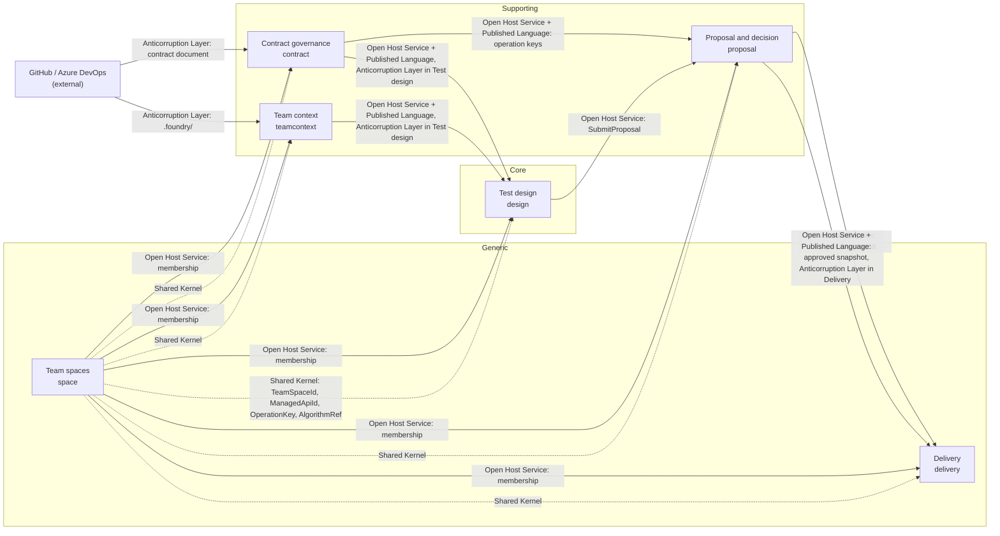

<!-- markdownlint-disable-file -->
# Context map

Strategic design of Microcks Foundry. It details the bounded contexts the delivered slices need and
restates the relationships ratified in `ARCHITECTURE.md` (§ Bounded contexts, § Context map,
§ Code organization). `ARCHITECTURE.md` prevails on modules and dependency direction; the PRD
prevails on requirements.

Contexts are packages inside the layer modules, never Maven modules of their own
(`ARCHITECTURE.md` § Enforced boundaries). `traffic`, `divergence` and `coverage` are described in
`ARCHITECTURE.md` and are not detailed here until their own slice is built.

Only what the delivered slices need is drawn. A relationship of the ratified map whose two ends are
not both built here is named under *Ratified relationships this slice set does not build* instead of
being drawn as if it existed.

## Bounded contexts

| Context | Package | Subdomain | Aggregates | Tactical design |
|---|---|---|---|---|
| Test design | `design` | Core | none — value objects and domain services | [design.md](design.md) |
| Contract governance | `contract` | Supporting | none in this slice set | [contract.md](contract.md) |
| Proposal and decision | `proposal` | Supporting | `Proposal` | [proposal.md](proposal.md) |
| Team context | `teamcontext` | Supporting | none in this slice set | [teamcontext.md](teamcontext.md) |
| Delivery | `delivery` | Generic | `Delivery` | [delivery.md](delivery.md) |
| Team spaces | `space` | Generic | none in this slice set | [space.md](space.md) |

Subdomain classes are those of `ARCHITECTURE.md` § Subdomains: Test design is the reason the product
exists (named design techniques, value origin, traceability), so it carries the full tactical
model; Contract governance, Proposal and decision and Team context serve it with standard
patterns; Delivery and Team spaces are commodity integration and partitioning.

Each tactical design states why its context holds an aggregate or none. `Proposal` and `Delivery`
are the only two of this slice set: everywhere else, the state of one identity is written once and
no invariant spans its successive or concurrent changes.

## Relationships

| Pair | Pattern | Why |
|---|---|---|
| GitHub, Azure DevOps → Contract governance | Anticorruption Layer | No external type enters the core; the adapter reads a document at a revision and hands the context a `ContractRevision`. The refusal of a document that is not OpenAPI 3.x is decided in the context on the format the adapter reports (`ARCHITECTURE.md` § Context map). |
| GitHub, Azure DevOps → Team context | Anticorruption Layer | `.foundry/` files are read at a revision and translated into `TeamConfiguration` entries; the context sees no file format (`ARCHITECTURE.md` § Context map). |
| Contract governance → Test design | Open Host Service and Published Language (`application.contract.api`), **Anticorruption Layer in Test design** | The upstream publishes one stable read — operations, their declared responses, their field constraints — and hides its own types (`ARCHITECTURE.md` § Context map). Test design is the Core downstream, so it never adopts that published shape as its own: `application.design` translates it into this context's values before any designer runs. There is exactly one coupling point, the `api` package; no domain type of one context is read by another. |
| Contract governance → Proposal and decision | Open Host Service and Published Language (`application.contract.api`) | The pre-delivery checks verify that every operation key of the proposed document matches the contract, which is a read of the same published language. Proposal and decision is a Supporting consumer: it reads the published keys as published and keeps no copy. The reverse direction — this context submitting an audit fix to the proposal open host service (`ARCHITECTURE.md` § Context map) — is not built here. |
| Team context → Test design | Open Host Service and Published Language (`application.teamcontext.api`), **Anticorruption Layer in Test design** | Test design needs one immutable, versioned snapshot — seed, dictionaries, PR language — for a reproducible generation (`ARCHITECTURE.md` § Context map). The upstream publishes it as one stable view, `TeamContextView`, and hides its own values; it grows by addition only. Test design is the Core downstream, so it never adopts that shape: `application.design` translates the view into this context's `Seed` and dictionary values before any designer runs. |
| Test design → Proposal and decision | Open Host Service (`application.proposal.api`) | One entry point to the human decision; every output goes through `Proposal` (`ARCHITECTURE.md` § Guiding decisions, § Context map). |
| Proposal and decision → Delivery, the approval event | Customer/Supplier through `ProposalApproved` | A delivery exists only for an approved snapshot (`ARCHITECTURE.md` § Context map). The event is a notification, not a model Delivery reads from: it carries identities only, the downstream keeps no copy of it and translates nothing, and what it must carry for a delivery to start is agreed between the two — which is Customer/Supplier, not a published model. The model Delivery does read is the row below. |
| Proposal and decision → Delivery, the snapshot read | Open Host Service and Published Language (`application.proposal.api`), **Anticorruption Layer in Delivery** | The approved files, their content and their content hashes are published as one stable view, `ApprovedSnapshotView`, and Delivery never reads this context's repository. Delivery does not keep that published shape: it copies each approved file into an `ArchiveEntry` of its own, which is what lets the archive carry the approved bytes however the proposal moves on. A local copy of a published view is an anticorruption layer, however small the translation. |
| Team spaces → every context | Shared Kernel (`TeamSpaceId`, `ManagedApiId`, `OperationKey`, `AlgorithmRef`) and Open Host Service (`application.space.api`) | Isolation by team: every stored identity carries `TeamSpaceId` and every read is scoped by it (`ARCHITECTURE.md` § Context map, `CONTRIBUTING.md` § Where code belongs). The identities are shared types. The membership check every other context calls before it answers is a published read of this context; no caller reaches into its storage (rule `R2` and rule `R9`, `ARCHITECTURE.md` § Planned architecture rules). |

Deliberate non-relationships, from `ARCHITECTURE.md` § Context map: Microcks triggers nothing in
Foundry, and Foundry serves no mock and gives no verdict.

### Ratified relationships this slice set does not build

| Ratified relationship | Why it is not drawn | Slice that brings it |
|---|---|---|
| Delivery → GitHub, Azure DevOps (Anticorruption Layer for branch, pull request and ZIP) | The only channel this slice set builds is the ZIP archive: the adapter of `ArchiveWriter` stores the archive where the instance serves it from and hands it back when it is fetched. There is no upstream model to translate and no forge involved, so no story of this slice set needs this edge | the story that opens a pull request on a forge (PRD E1.5, E1.20) |
| Microcks → Contract governance (Anticorruption Layer) | No story of this slice set reads a contract from Microcks: a contract document is loaded from the team's repository, and the ZIP being importable into Microcks is an output, not an input | the story that imports an API from Microcks (PRD E1.1) |
| Enterprise plugin JARs → Test design (Published Language `foundry-plugin-api`) | No story of this slice set adds, discovers or runs a plugin; the versioned algorithm each example cites is a built-in generator read through one gateway | the story that ships `foundry-plugin-api` and its discovery (PRD §8) |
| Traffic observation, Divergences, Coverage, AI providers | Out of the epic | their own epics (`ARCHITECTURE.md` § Delivery order) |

## Story to context

| Story | Contexts it touches | What it adds |
|---|---|---|
| EP-001-S01 — a ZIP of nominal examples from an OpenAPI | `contract`, `design`, `proposal`, `delivery`, `space` | the first end-to-end path: load a REST contract, design one nominal example per operation, accept and approve, prepare the archive |
| EP-001-S03 — configure the team space | `space`, `teamcontext`, `design` | the space partition and its membership, the team configuration snapshot (seed, PR language), the seed pinned in the generation manifest |
| EP-001-S05 — declared errors and one negative per constraint | `contract`, `design`, `proposal` | declared error responses and field constraints read from the contract, two more design techniques, the report of a missing declared error |
