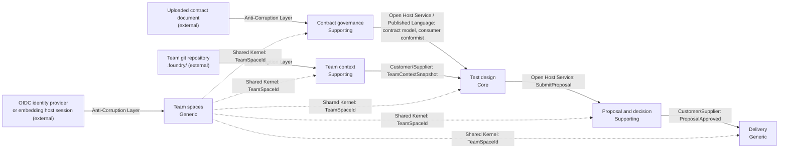

<!-- markdownlint-disable-file -->
# Context map

Working context map for the bounded contexts the delivered slices touch. It derives from
`ARCHITECTURE.md` § Domain model, which stays the authority for the contexts, subdomain types and
relationships; this file adds the per-slice detail implementation needs and never contradicts it.
The relationship arrows drawn below are the ones the current slices exercise; the complete map,
including the contexts of later tranches, is in `ARCHITECTURE.md` § Context map.

## Bounded contexts

| Context | Package | Subdomain | Aggregates | Tactical design | In the current slices |
| --- | --- | --- | --- | --- | --- |
| Test design | `design` | Core | none | [design.md](design.md) | yes |
| Divergences | `divergence` | Core | `Divergence` | — | no (later tranche) |
| Proposal and decision | `proposal` | Supporting | `Proposal` | [proposal.md](proposal.md) | yes |
| Traffic observation | `traffic` | Supporting | `PathTemplateSet` | — | no (later tranche) |
| Contract governance | `contract` | Supporting | `ManagedApi` | [contract.md](contract.md) | yes |
| Team context | `teamcontext` | Supporting | none in the current slices | [teamcontext.md](teamcontext.md) | yes (read-only snapshot) |
| Delivery | `delivery` | Generic | `Delivery` | [delivery.md](delivery.md) | yes (archive channel only) |
| Team spaces | `space` | Generic | `TeamSpace` | [space.md](space.md) | yes (identity and scope only) |
| Coverage | `coverage` | Generic, read-only | none: projections | — | no: the absence of a declared error response is reported by the generation read model of the Test design context, so no coverage projection is opened yet |

Bounded contexts are packages inside the layer modules, as `ARCHITECTURE.md` § Modules decides;
no context of this map is a Maven module of its own.

## Relationships exercised by the current slices

| Pair | Pattern | Why |
| --- | --- | --- |
| Uploaded contract document → Contract governance | Anti-Corruption Layer | The document is read at the boundary and translated into `ContractRevision`; no parser type reaches the domain. The unsupported-format refusal is decided by a domain policy on the format the reader found. |
| Team git repository (`.foundry/`) → Team context | Anti-Corruption Layer | Files are read at a revision; the domain sees `TeamContextSnapshot` or the name of the missing configuration key. |
| Identity provider → Team spaces | Anti-Corruption Layer | A standalone OIDC subject or the embedding host session is translated into `MemberId` and the spaces that member belongs to. |
| Contract governance → Test design | Open Host Service / Published Language upstream, conformist downstream | As `ARCHITECTURE.md` § Context map decides: OpenAPI is itself a published language, so the contract model (`ContractRevision`, `Operation`, `DeclaredResponse`, `Constraint`) is published as-is and consumed untranslated. Nothing of the upstream aggregate `ManagedApi` crosses, so the Core downstream has no foreign model to protect itself from, and architecture rule R1 keeps `domain.contract.model` as the only cross-context domain dependency besides the shared kernel. |
| Team context → Test design | Customer/Supplier | The generation needs an immutable, revision-pinned snapshot (seed, PR language, dictionaries) for reproducibility. |
| Test design → Proposal and decision | Open Host Service | One entry point to human decision: the generation submits files and review items and never writes a proposal's internals. |
| Proposal and decision → Delivery | Customer/Supplier through `ProposalApproved` | A delivery exists only for an approved snapshot. |
| Team spaces → every context above | Shared Kernel (`TeamSpaceId`) | Isolation by team: every command, query, repository and gateway of every context is scoped by `TeamSpaceId`; see [space.md](space.md) § Team-space scope. |

## Journeys under construction and the contexts they cross

The briefs under [stories/](stories/) map each delivered journey to these contexts and to the
slices of each event model.

| Journey | Contexts | What each one carries |
| --- | --- | --- |
| Nominal examples from a contract document, reviewed, approved, then downloaded as an archive | `contract`, `design`, `proposal`, `delivery`, `space` | `contract`: load the document, refuse an unsupported format. `design`: one nominal example per operation. `proposal`: review, pending-item rule, approval, approved snapshot. `delivery`: the archive and its availability. `space`: the caller's space and membership. |
| Team space configuration: seed, pull-request language and dictionaries | `space`, `teamcontext`, `design` | `space`: the caller's space and the scope of every read. `teamcontext`: the snapshot read from `.foundry/config.yaml` (seed, PR language, dictionaries) and the dictionary list of one space. `design`: the generation refusal when the snapshot has no seed, and the manifest that makes two runs identical. |
| Declared-error examples and one negative example per constraint | `contract`, `design`, `proposal` | `contract`: declared responses and declared constraints of each operation. `design`: the declared-error and negative-per-constraint techniques and the per-operation gaps. `proposal`: one review item per produced example. |
