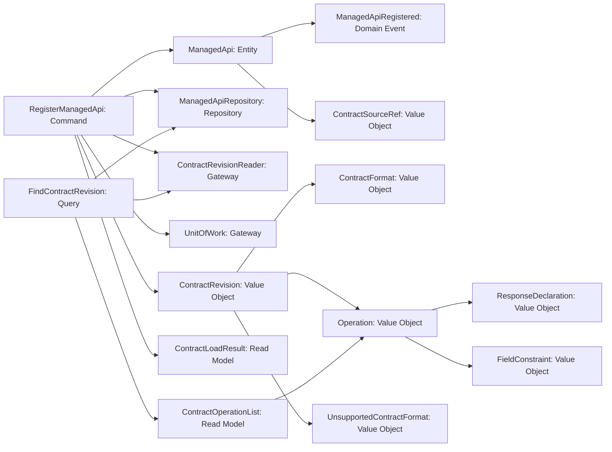

<!-- markdownlint-disable-file -->
# Tactical design — Contract governance (`contract`)

Supporting subdomain. Packages: `domain.contract`, `domain.contract.model`, `application.contract`
(`ARCHITECTURE.md` § Code organization). Event model:
[../domain/event-model/contract.md](../domain/event-model/contract.md).

## Aggregates

None in this slice set.

An aggregate exists only to protect an invariant that must hold across the successive or concurrent
changes of one identity, and an aggregate of the target model becomes one in the code only once a
slice gives it such an invariant (`ARCHITECTURE.md` § Aggregates). In this slice set an API is
registered once: its name, its version and the
source its contract is read from are written at registration and no story changes them. The two
invariants the ratified model gives `ManagedApi` — exactly one primary source, one update mode
(`ARCHITECTURE.md` § Aggregates) — are checked at that single construction, so they belong to a
self-validating entity, not to a transaction boundary. The ratified aggregate, its secondary
source, its update mode and its traffic binding arrive with the stories that change a source or an
update mode (PRD E2.4, E2.13) and with traffic observation; this slice set builds none of them.

The contract document itself is never inside anything: it is an immutable `ContractRevision` read
at a revision (`ARCHITECTURE.md` § Aggregates, § Rejected aggregates).

### `ManagedApi` — Entity

- **Identity:** `ManagedApiId`, inside the `TeamSpaceId` of its space.
- **Holds:** the API name, the API version and the `ContractSourceRef` its contract is read from.
- **Validated at construction:** a non-blank name and version, and exactly one contract source.
- **References by identity only:** `TeamSpaceId`.
- **Set rule, not an invariant of this entity:** one registration per API name and version inside a
  space. It spans different identities, so it is a storage constraint the repository relies on, not
  a reason to enlarge anything (`ARCHITECTURE.md` § Aggregates, set validation).
- **Raises:** `ManagedApiRegistered`, the fact of its single registration.

## Value objects

Immutable, equal by value, validated in their constructor (`CONTRIBUTING.md` § Where code belongs).

| Value object | Holds | Rejects at construction |
|---|---|---|
| `ManagedApiId`, `OperationKey` | shared kernel identities; `OperationKey` is the `VERB /path` index of the APIExamples artefact | an empty or malformed value |
| `ContractSourceRef` | where a contract document is read: the repository locator of the document | a blank locator |
| `ContractFormat` | the format a source document declares: `OpenApi3` or `Other` | nothing; `Other` is a legitimate value, refused later |
| `ContractRevision` | one immutable reading of a contract: API name, version, revision hash and its operations | a document whose `ContractFormat` is not `OpenApi3`, with an `UnsupportedContractFormat` outcome that carries the detected format and the supported ones |
| `Operation` | an `OperationKey`, its success response and its declared error responses | a duplicate `OperationKey`, no success response |
| `ResponseDeclaration` | a status code, its kind (`Success`, `ClientError`, `ServerError`) and the shape of its payload | a status code outside the HTTP ranges |
| `FieldConstraint` | a field path and one constraint the contract declares: `Type`, `Format`, `Pattern` or `Required`, with its expectation | an unknown kind, a blank field path |
| `UnsupportedContractFormat` | the detected format and the formats Foundry supports | an empty supported list |

Refusing a document that is not OpenAPI 3.x is a construction rule of `ContractRevision`, not a
state anything protects: it is checked once, so it belongs to the self-validating value object.
The message a person reads is assembled from the message files; the value object carries the facts.

`domain.contract.model` holds these contract values. They stay inside this context: what crosses a
boundary is the read model of `application.contract.api` below, never a domain type (rule `R1` and
rule `R2`, `ARCHITECTURE.md` § Planned architecture rules).

## Domain events

| Event | Payload | Raised by | Consumers |
|---|---|---|---|
| `ManagedApiRegistered` | the space, the API identity, the member who registered it and the revision hash of the contract that was read — identities only, and no time, since nothing of this slice set dates the fact and the domain reads no clock (rule `R5` at `ARCHITECTURE.md` § Planned architecture rules) | the `ManagedApi` entity, when it is registered | none in this slice set |

Registering an API is the successful outcome of a business command, so it is recorded as a domain
event even though this context holds no aggregate root yet: a write-once entity records the fact of
its creation (`ARCHITECTURE.md` § Aggregates). The event carries identities only, never the
contract document. Its ratified consumers — Traffic observation, Divergences and Coverage
(`ARCHITECTURE.md` § Domain events) — are not part of this slice set, and no acceptance criterion
observes the event: what the stories observe is `ContractLoadResult`, which also carries the
`ManagedApiId` the following commands use. A refused document raises nothing, because nothing was
registered.

`PrimarySourceDesignated`, `ContractUpdateModeChanged` and `ContractAudited` belong to the stories
that change a source, an update mode or run an audit.

## Repositories

| Interface | Layer | Why there |
|---|---|---|
| `ManagedApiRepository` | Application (`application.contract.port`) | `ManagedApi` is an entity with no invariant to guard across successive changes, so by the stack rule its repository is an Application-layer contract rather than a Domain one. It returns the registration by identity, refuses a second registration of the same API name and version in a space through its storage constraint, and scopes every read by `TeamSpaceId`. |

These stories need no durable store: the implementation is an in-memory one in
`infrastructure.persistence.contract`, and the choice of a durable adapter belongs to the story
that requires survival across restarts.

## Gateways

One interface per outside dependency the application calls, named for what it asks, in
`application.contract.port` (`CONTRIBUTING.md` § Where code belongs), implemented in the
infrastructure layer.

| Interface | Layer | What it asks | Evolution rule |
|---|---|---|---|
| `ContractRevisionReader` | Application | the contract document of a source, as it stands at its current revision, with the format the document declares | additions only; the adapter reports a format it does not support instead of failing |
| `UnitOfWork` | Application (`application.shared`) | commit one write and its journal entries atomically (`ARCHITECTURE.md` § Domain events, Transactions) | additions only |

The whole anticorruption layer sits in the reader's adapters (`infrastructure.openapi`,
`infrastructure.github`): the parser, the detection of the document's format and the translation
into `ContractRevision` values. No external type crosses into `application` or `domain`
(rule `R8`, `ARCHITECTURE.md` § Planned architecture rules). Which parser library the adapter uses
is an implementation choice of that adapter.

## Published contract for other contexts

`application.contract.api` publishes `FindContractRevision` and the `ContractOperationList` read
model (operations, declared responses, field constraints). It is the only package another context
may call (`CONTRIBUTING.md` § Where code belongs, rule `R2` at `ARCHITECTURE.md` § Planned
architecture rules), and it is the only coupling point this context offers.

| Consumer | What it needs from this contract |
|---|---|
| Test design (Core) | every operation, its success response, its declared error responses and its field constraints. Being the Core downstream it translates them into its own values in an anticorruption layer of `application.design`; it never adopts these shapes (see [context-map.md](context-map.md)) |
| Proposal and decision | the operation keys of the contract revision, to check that the proposed document matches them before anything leaves |

It grows by addition only; a reader ignores a field it does not know.

## Component diagram

