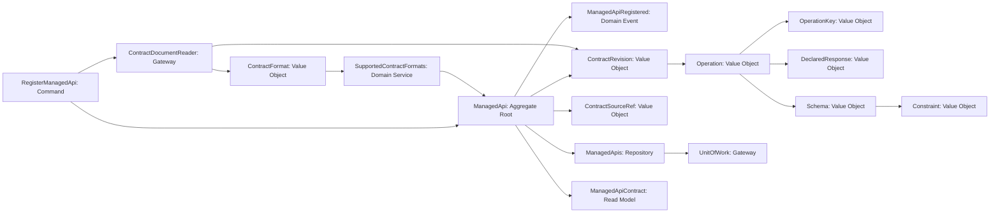

<!-- markdownlint-disable-file -->
# Tactical design — Contract governance (`contract`)

Supporting subdomain. Package `io.microcks.foundry.<layer>.contract`, as `ARCHITECTURE.md`
§ Code organization decides. Event model:
[../domain/event-model/contract.md](../domain/event-model/contract.md).

## Reuse

| Element | Classification | Basis |
| --- | --- | --- |
| `ManagedApi` aggregate, its root and its primary-source invariant | reuse as specified | `ARCHITECTURE.md` § `ManagedApi` — Contract governance; no code exists yet, so the first slice writes it as specified |
| Published contract model (`ContractRevision`, `Operation`, `Schema`, `Constraint`) | reuse as specified | `ARCHITECTURE.md` § Code organization, `domain.contract.model` as the published language |
| `OperationKey`, `TeamSpaceId`, `ManagedApiId` | reuse as-is | shared kernel of `ARCHITECTURE.md` § Code organization |
| `ContractSourceRef` | extend | `ARCHITECTURE.md` lists Microcks and git sources; the current slice loads an uploaded document and needs no external integration, so `Upload` is added as a third kind with the same role rule |
| `ContractFormat` and the unsupported-format refusal | create new | no element of the architecture covers the refusal of a contract format the product does not support |
| Parsing, format detection and document reading | create new (adapter) | nothing exists; the architecture keeps parsers out of the domain and the application |

## Aggregate

### `ManagedApi` — root `ManagedApiId`

- Consistency boundary: one registered API of one team space, with its contract sources and the
  contract revision currently in force.
- Invariants held across successive changes of that identity:
  - exactly one source carries the `Primary` role; registering or designating a source never
    leaves zero or two;
  - a registered API belongs to exactly one team space and never changes space;
  - the contract revision in force is replaced only by a revision read from the primary source.
- References other aggregates by identity only (`TeamSpaceId`).
- The complete invariant set of this aggregate, including the update mode and the traffic binding
  of later tranches, stays in `ARCHITECTURE.md` § `ManagedApi` — Contract governance.

## Value objects

Immutable, equal by value, validated at construction; a value that cannot hold cannot exist.

| Value object | Holds | Validated at construction |
| --- | --- | --- |
| `ContractRevision` | `ApiName`, `ApiVersion`, `ContractFormat`, `ContractHash`, the operations | the hash is the hash of the document the operations were read from; at least one operation |
| `Operation` | `OperationKey`, the request schema, the declared responses | one declared response at most per status code |
| `OperationKey` | the verb and the path, as `VERB /path` | shared kernel; the verb is one of the REST verbs the contract format allows |
| `DeclaredResponse` | `StatusCode`, `ResponseKind` (`Success`, `ClientError`, `ServerError`), the body schema | the kind is derived from the status code and never set by hand |
| `Schema` | the declared type, the properties and their schemas, the declared constraints | a property name appears once |
| `Constraint` | `ConstraintKind` (`Type`, `Format`, `Pattern`, `Required`, `Bounds`) and the declared value of that constraint | the declared value matches the kind |
| `ContractSourceRef` | `SourceKind` (`Upload`, `Microcks`, `Git`), the location, `SourceRole` (`Primary`, `Secondary`) | a location that the kind requires is present |
| `ContractFormat` | the contract format the reader recognised | one of the recognised formats; `OpenApi3` is the only supported one |

## Domain services

- `SupportedContractFormats` — stateless and pure: answers whether a `ContractFormat` is
  supported and, when it is not, the refusal reason naming the supported REST contract format.
  The decision is the domain's; the adapter only reports which format it found.

## Domain events

Raised by `ManagedApi`, past tense, identities and hashes only, never schemas:

- `ManagedApiRegistered`.

## Repositories

| Interface | Aggregate | Layer |
| --- | --- | --- |
| `ManagedApis` | `ManagedApi` | Application, package `application.contract.port` |

Layer rule: `CONTRIBUTING.md` § Where code belongs and `ARCHITECTURE.md` § Code organization place
every interface the infrastructure implements in `application.<context>.port`. That project
decision overrides the stack default of placing an aggregate repository in the domain, and holds
for every repository and gateway of this repository's contexts. Every method is scoped by
`TeamSpaceId` ([space.md](space.md) § Team-space scope). Writes go through the shared `UnitOfWork`
port of `ARCHITECTURE.md` § Domain events.

## Gateways

| Interface | Outside dependency | What it asks, in business terms | Layer |
| --- | --- | --- | --- |
| `ContractDocumentReader` | the uploaded document, later a Microcks API or a git revision; the OpenAPI parser the PRD names | "read the contract at this source and give me its revision, or the contract format you found when it is not one I support" | Application, `application.contract.port` |
| `UnitOfWork` | the transaction manager of the store | "commit this aggregate and its journal entries as one unit, or none of them" | Application, `application.shared.port`; the shared interface of `ARCHITECTURE.md` § Domain events, described once in [proposal.md](proposal.md) § Gateways |

- The reader is the anti-corruption layer of this context: it detects the document's format,
  translates an `OpenApi3` document into a `ContractRevision`, and returns the detected
  `ContractFormat` without a revision otherwise. No parser type crosses into the application or
  the domain, which architecture rule R8 enforces once added.
- Evolution rule for the published contract model this context exposes to Test design
  (`ContractRevision`, `Operation`, `Schema`, `Constraint`, `DeclaredResponse`): additions only. A
  consumer ignores a constraint kind, a response kind or a property it does not know, so a new
  kind never breaks the Test design context.

## Components

