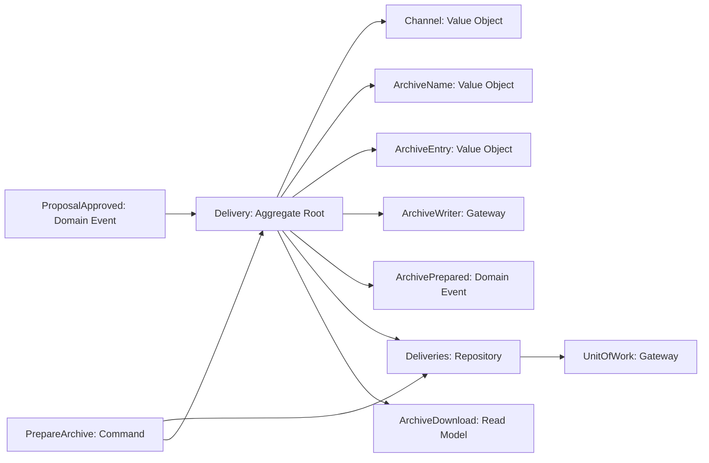

<!-- markdownlint-disable-file -->
# Tactical design — Delivery (`delivery`)

Generic subdomain. Package `io.microcks.foundry.<layer>.delivery`, as `ARCHITECTURE.md` § Code
organization decides. Event model:
[../domain/event-model/delivery.md](../domain/event-model/delivery.md).

## Reuse

| Element | Classification | Basis |
| --- | --- | --- |
| `Delivery` aggregate, its identity and its invariants | reuse as specified | `ARCHITECTURE.md` § `Delivery` — Delivery; no code exists yet, so the first slice writes it as specified |
| `TeamSpaceId`, `ProposalId` | reuse as-is | shared kernel and reference by identity |
| `Channel`, `ArchiveEntry` | create new | the current slices need the archive channel as a value and the archive content as entries |
| Pull-request channels | not in these slices | no story of this pass delivers to a forge |

## Aggregate

### `Delivery` — root `DeliveryId`, natural identity `(ProposalId, approved revision, Channel)`

- Consistency boundary: one delivery of one approved revision through one channel.
- Invariants held across successive changes of that identity:
  - a delivery is created only from an approved snapshot of the proposal it names;
  - it is idempotent per approved revision and channel: asking twice yields the same delivery and
    the same archive hash, never a second one;
  - its archive is downloadable only once it exists, so nothing is downloadable before approval.
- References the proposal by identity only; the files it delivers come from the approved snapshot
  the approval froze, never from the live proposal.

## Value objects

| Value object | Holds | Validated at construction |
| --- | --- | --- |
| `Channel` | `Archive` in the current slices | the value is known |
| `ArchiveEntry` | the entry path inside the archive and the content hash of that entry | the path is relative and has no parent segment; one entry per path |
| `ArchiveName` | the file name offered for download, built from the API name and version | not empty; it names the API and the version |

## Domain events

Raised by the `Delivery` root, past tense, identities and hashes only:

- `ArchivePrepared`.

## Repositories

| Interface | Aggregate | Layer |
| --- | --- | --- |
| `Deliveries` | `Delivery` | Application, package `application.delivery.port` |

Layer rule as in [contract.md](contract.md) § Repositories. Every method is scoped by
`TeamSpaceId`; the lookup by `(ProposalId, approved revision, Channel)` is what makes the command
idempotent. Writes go through the shared `UnitOfWork` port.

## Gateways

| Interface | Outside dependency | What it asks, in business terms | Layer |
| --- | --- | --- | --- |
| `ArchiveWriter` | the archive format and the place the archive is kept until it is downloaded | "pack these approved files under these entry paths and tell me the archive's hash" | Application, `application.delivery.port` |
| `UnitOfWork` | the transaction manager of the store | "commit this aggregate and its journal entries as one unit, or none of them" | Application, `application.shared.port`; the shared interface of `ARCHITECTURE.md` § Domain events, described once in [proposal.md](proposal.md) § Gateways |

## Components

A member triggers `PrepareArchive`; this context reacts to no event on its own. `ProposalApproved`
is drawn as the upstream fact that supplies the approved snapshot a delivery may be built from; it
belongs to the Proposal and decision context ([proposal.md](proposal.md)).
