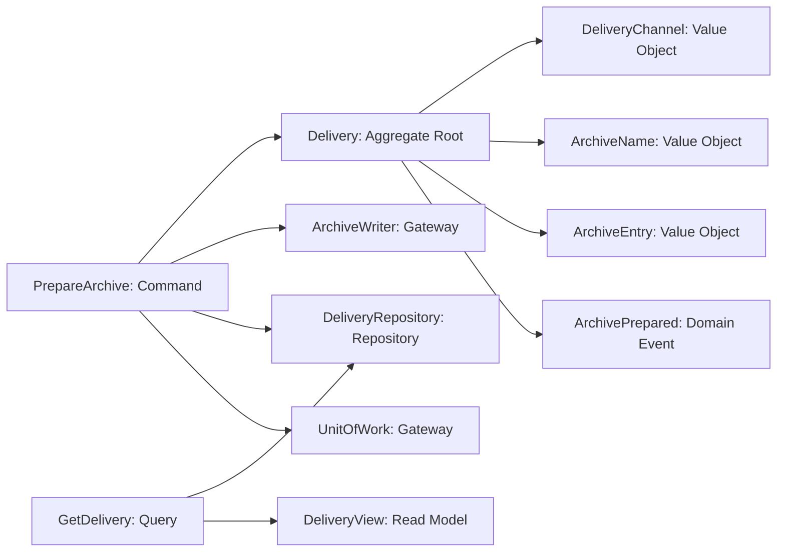

<!-- markdownlint-disable-file -->
# Tactical design — Delivery (`delivery`)

Generic subdomain. Packages: `domain.delivery`, `application.delivery`
(`ARCHITECTURE.md:446-473`). Event model:
[../domain/event-model/delivery.md](../domain/event-model/delivery.md).

## Aggregates

### `Delivery` — Aggregate Root

- **Root and identity:** `DeliveryId`, the natural identity `(ProposalId, approved revision,
  channel)`, inside the `TeamSpaceId` of its space (`ARCHITECTURE.md:235`, invariants at
  `ARCHITECTURE.md:236`).
- **Consistency boundary:** one delivery of one approved revision on one channel, with the entries
  it contains. The identity is what makes a repeated request idempotent, which is an invariant
  across successive requests for the same proposal revision — hence an aggregate rather than a
  value object.
- **Invariants:**
  - a delivery is created only from an `ApprovedSnapshot`; without approval there is no delivery
    and nothing to download;
  - it is idempotent per approved revision and channel: a second request yields the same delivery
    and the same entries;
  - its entries are exactly the files of the approved snapshot, at the output paths of the team
    configuration, each with the content hash the snapshot froze.
- **References by identity only:** `TeamSpaceId`, `ProposalId`.
- **Raises:** `ArchivePrepared`.

## Value objects

| Value object | Holds | Rejects at construction |
|---|---|---|
| `DeliveryId` | the natural identity of a delivery | a missing proposal, revision or channel |
| `DeliveryChannel` | `ZipArchive`, `GitHubPullRequest` or `AzureDevOpsPullRequest`; this slice set uses `ZipArchive` only | any other value |
| `ArchiveName` | the name under which the archive is offered, built from the API name and version | a blank name |
| `ArchiveEntry` | the path of a file inside the archive and its content hash | an absolute path, an empty hash |

The APIExamples document is written at the PRD's output path,
`examples/<api>-<version>.examples.yaml`, which is the path the archive entry carries.

## Domain events

| Event | Payload | Consumers |
|---|---|---|
| `ArchivePrepared` | identities, the revision, the channel, the archive name and the entry count | Proposal, decision journal (`ARCHITECTURE.md:404`) |

`PullRequestOpened` and `DeliveryFailed` belong to the pull-request channel and are not part of
this slice set.

## Repositories

| Interface | Layer | Why there |
|---|---|---|
| `DeliveryRepository` | Domain (`domain.delivery`) | it returns the `Delivery` aggregate and guards its idempotence; by the stack rule a repository that persists an aggregate belongs to the Domain layer. Every read is scoped by `TeamSpaceId`. |

In-memory in `infrastructure.persistence.delivery` for these stories, as for the other contexts.

## Gateways

| Interface | Layer | What it asks | Evolution rule |
|---|---|---|---|
| `ArchiveWriter` | Application (`application.delivery.port`) | store the approved files as one archive a person can download, say where it can be fetched, and hand that archive back when it is fetched | additions only |
| `UnitOfWork` | Application (`application.shared`) | commit one aggregate and its journal entries atomically | additions only |

The archive format, its bytes and where they are stored belong to the adapter
(`infrastructure` layer): the context states the entries and their paths only. `DeliveryView`
surfaces the location the gateway reports, so the entry point can serve the archive of an approved
snapshot without any context handling bytes.

## Contracts this context calls

`application.proposal.api` for the approved snapshot a delivery is built from, and for the
`ProposalApproved` integration event that may trigger it (`ARCHITECTURE.md:202`). Delivery
publishes `application.delivery.api` for its own consumers.

## Component diagram

