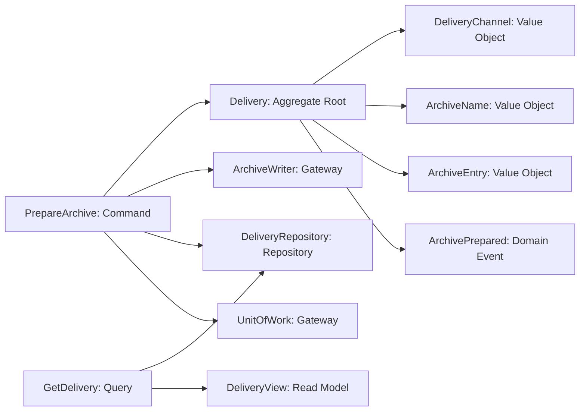

<!-- markdownlint-disable-file -->
# Tactical design — Delivery (`delivery`)

Generic subdomain. Packages: `domain.delivery`, `application.delivery`
(`ARCHITECTURE.md` § Code organization). Event model:
[../domain/event-model/delivery.md](../domain/event-model/delivery.md).

## Aggregates

### `Delivery` — Aggregate Root

- **Root and identity:** `DeliveryId`, the natural identity `(ProposalId, approved revision,
  channel)`, inside the `TeamSpaceId` of its space (`ARCHITECTURE.md` § Aggregates).
- **Consistency boundary:** one delivery of one approved revision on one channel, with the entries
  it contains. Because the identity is natural, every repeated or concurrent request for the same
  proposal revision and channel addresses the same identity, and the invariant that it yields one
  delivery and one set of entries holds across those successive and concurrent changes. That is the
  transaction boundary, and it is why this context has an aggregate where a write-once registration
  would not need one.
- **Invariants:**
  - a delivery is created only from an `ApprovedSnapshot`; without approval there is no delivery
    and nothing to download;
  - it is idempotent per approved revision and channel: a second request yields the same delivery
    and the same entries;
  - its entries are exactly the files of the approved snapshot, at the output paths of the team
    configuration, each with the content hash the snapshot froze.
- **References by identity only:** `TeamSpaceId`, `ProposalId`.
- **Raises:** `ArchivePrepared`.

## Value objects

| Value object | Holds | Rejects at construction |
|---|---|---|
| `DeliveryId` | the natural identity of a delivery | a missing proposal, revision or channel |
| `DeliveryChannel` | `ZipArchive`, the one channel of this slice set | any other value |
| `ArchiveName` | the name under which the archive is offered, built from the API name and version | a blank name |
| `ArchiveEntry` | the path of a file inside the archive and its content hash | an absolute path, an empty hash |

The pull-request channels of the ratified model (`ARCHITECTURE.md` § Aggregates) add their members
to `DeliveryChannel` with their own slice; nothing of them is designed here.

The APIExamples document is written at the PRD's output path,
`examples/<api>-<version>.examples.yaml`, which is the path the archive entry carries.

## Domain events

| Event | Payload | Consumers |
|---|---|---|
| `ArchivePrepared` | identities, the revision, the channel, the archive name and the entry count | Proposal, decision journal (`ARCHITECTURE.md` § Domain events) |

`PullRequestOpened` and `DeliveryFailed` belong to the pull-request channel and are not part of
this slice set.

## Repositories

| Interface | Layer | Why there |
|---|---|---|
| `DeliveryRepository` | Domain (`domain.delivery`) | it returns the `Delivery` aggregate and guards its idempotence; by the stack rule a repository that persists an aggregate belongs to the Domain layer. Every read is scoped by `TeamSpaceId`. |

In-memory in `infrastructure.persistence.delivery` for these stories.

## Gateways

| Interface | Layer | What it asks | Evolution rule |
|---|---|---|---|
| `ArchiveWriter` | Application (`application.delivery.port`) | store the approved files as one archive a person can download, say where it can be fetched, and hand that archive back when it is fetched | additions only |
| `UnitOfWork` | Application (`application.shared`) | commit one aggregate and its journal entries atomically | additions only |

The archive format, its bytes and where they are stored belong to the adapter
(`infrastructure` layer): the context states the entries and their paths only. `DeliveryView`
reports the outcome of the read under the names `CONTRIBUTING.md` § Naming fixes — `Accepted` and
`RefusalReason` — and carries the location the gateway reported, so the entry point can serve the
archive of an approved snapshot without any context handling bytes. While nothing is approved,
`Accepted` is no, the location is absent and the refusal says so.

## Contracts this context calls

| Contract called | What this context asks for |
|---|---|
| `application.proposal.api` | `ProposalApproved`, the integration event that may trigger a delivery, and `FindApprovedSnapshot` — asked for the space, the proposal and the caller — which answers whether an approved snapshot exists, the approved revision, the snapshot hash and every file of the snapshot with its content and its content hash: the inputs `ArchiveWriter` needs to write the archive and the entries the aggregate records (`ARCHITECTURE.md` § Context map) |
| `application.space.api` | `FindSpaceMembership` for the caller, before a delivery is prepared or read |

`application.delivery` holds this context's anticorruption layer: it does not keep the published
`ApprovedSnapshotView` shape, it copies each approved file into an `ArchiveEntry` of its own, at the
output path of the team configuration, with the content hash the snapshot froze. That is what lets
the archive carry the approved bytes however the proposal moves on afterwards, and it is the
relationship drawn on [context-map.md](context-map.md).

This context publishes nothing: no story of this slice set names a consumer of a delivery, and the
archive is reached through the entry point, on `DeliveryView`. A published package of its own
arrives with the first story that names a consumer for it.

## Component diagram

