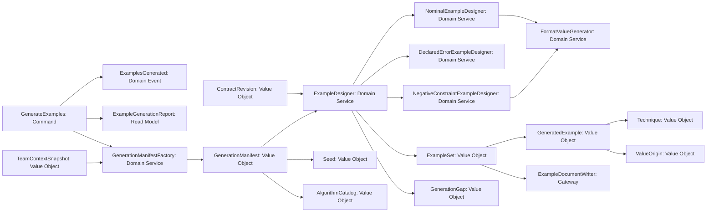

<!-- markdownlint-disable-file -->
# Tactical design — Test design (`design`)

Core subdomain. Package `io.microcks.foundry.<layer>.design`, as `ARCHITECTURE.md` § Code
organization decides. Event model:
[../domain/event-model/design.md](../domain/event-model/design.md).

## Reuse

| Element | Classification | Basis |
| --- | --- | --- |
| A context with no aggregate: rules in value objects and domain services | reuse as specified | `ARCHITECTURE.md` § Guiding decisions (test design is a deterministic, pure domain) and § Rejected aggregates (`Example`, `ExampleSet`) |
| `GenerationManifest` and its pinned inputs | reuse as specified | `ARCHITECTURE.md` § Reproducibility |
| `Seed`, `ValueOrigin`, `AlgorithmRef`, `OperationKey`, `TeamSpaceId` | reuse as-is | shared kernel of `ARCHITECTURE.md` § Code organization |
| Published contract model | reuse as-is | consumed untranslated from Contract governance, see [context-map.md](context-map.md) |
| `AlgorithmCatalog` built by a factory that rejects a duplicate `(id, version)` | reuse as specified | `ARCHITECTURE.md` § Rejected aggregates |
| `generators.format v1` | reuse as specified | PRD § 8 and § 9 value resolution order |
| `Technique`, the three technique designers, `GenerationGap` | create new | nothing exists; the stories ask for the nominal, declared-error and negative-per-constraint techniques and for the per-operation gap report |

## Aggregates

None. No identity of this context changes over time: a generation is a pure function of its
manifest, and the reviewable result is held by the Proposal and decision context. The invariants
the stories state are construction invariants of value objects (an example always carries its
technique, its algorithm reference and the origin of each value) or rules of a domain service
(one example per operation, one negative example per declared constraint), so no aggregate is
created here.

## Value objects

Immutable, equal by value, validated at construction.

| Value object | Holds | Validated at construction |
| --- | --- | --- |
| `Technique` | one of `Nominal`, `DeclaredError`, `NegativePerConstraint` | the value is one of the three the stories name |
| `GeneratedExample` | `OperationKey`, `Technique`, `ExampleName`, the request values, the response values, the declared response it reproduces when it has one, the violated constraint when it has one, `AlgorithmRef`, the origin of each value | a `DeclaredError` or `NegativePerConstraint` example carries a declared response; every value carries a `ValueOrigin`; the name is unique inside its operation and technique |
| `ExampleSet` | the generated examples of one contract revision, as a first-class collection | no two examples share an operation, a technique and a name; iteration order is the contract's operation order, then the technique order, then the name |
| `GenerationManifest` | `ContractHash`, the team context snapshot hash, the requested techniques, `Seed`, the algorithm references in their deterministic order, `ManifestHash` | every requested technique has an algorithm reference; the manifest hash is derived from the other fields only |
| `GenerationGap` | `OperationKey` and `GapKind` (`NoDeclaredErrorResponse`) | the kind is known |
| `Seed` | the seed of the team space | shared kernel; a seed always has a value, so a generation without one cannot be built |
| `ValueOrigin` | one of `Contract`, `GherkinExamples`, `Dictionary`, `Memory`, `Generator`, `Ai`, and the reference of that source | shared kernel; a `Generator` origin carries an `AlgorithmRef` |
| `AlgorithmCatalog` | the algorithm descriptors available to a generation, as a first-class collection | rejects a duplicate `(id, version)`; built once at composition |

## Domain services

Pure and deterministic: seed and time are inputs, no clock, no randomness, no input or output, as
`CONTRIBUTING.md` § Domain changes and architecture rule R5 require.

- `ExampleDesigner` — turns a contract revision, a team context snapshot and a set of techniques
  into an `ExampleSet` and the list of `GenerationGap`. It delegates to one designer per
  technique and never invents a response the contract does not declare.
- `NominalExampleDesigner` — one example per operation, conforming to the declared response
  schema of that operation.
- `DeclaredErrorExampleDesigner` — one example per declared error response; reports a
  `NoDeclaredErrorResponse` gap for an operation that declares none.
- `NegativeConstraintExampleDesigner` — one example per declared constraint of a request schema,
  each attached to the declared validation error response of its operation.
- `FormatValueGenerator` (`generators.format v1`) — a valid value from the declared format or the
  field name, from the seed, the field path and the algorithm reference.
- `GenerationManifestFactory` — builds the manifest from the pinned inputs; two runs of identical
  inputs build an equal manifest.

## Domain events

- `ExamplesGenerated` — past tense, immutable, identities and hashes only. This context has no
  aggregate root to raise it, so the `GenerateExamples` use case publishes it after the proposal
  is persisted, as the integration event of `application.design.api` that `ARCHITECTURE.md`
  § Code organization and § Domain events already place here. It carries no example payload: a
  consumer reads the examples through the proposal or the generation report.

## Repositories

None: this context has no aggregate, so it has no repository.

## Gateways

| Interface | Outside dependency | What it asks, in business terms | Layer |
| --- | --- | --- | --- |
| `ExampleDocumentWriter` | the document serialiser that writes the APIExamples format | "write this example set as the examples document of this API and version, the same bytes for the same set" | Application, `application.design.port` |

- Byte stability is the writer's responsibility: a fixed key order and a fixed encoding, pinned by
  the reference-output test `CONTRIBUTING.md` § Domain changes requires. The domain decides the
  content and its order through `ExampleSet`; the writer never reorders.
- The team context snapshot is read through the Team context gateway
  ([teamcontext.md](teamcontext.md) § Gateways) and the result is submitted through the Proposal
  open host service; neither is a gateway of this context.
- No plugin discovery in these slices: the `AlgorithmCatalog` is built from the built-in
  descriptors supplied at composition. The discovery gateway arrives with the story that
  introduces `foundry-plugin-api`.
- No value-suggestion gateway: these slices run without AI.

## Interfaces this context publishes

`GenerateExamples` is the entry point the team-space configuration journey and the declared-error
journey both reach the generation through: the first supplies the seed and the pull-request
language of the team context, the second asks for the declared-error and negative-per-constraint
techniques. Evolution rule: additions only — a new `Technique` or a new field of
`ExampleGenerationReport` never changes the meaning of the existing ones, and a caller that does
not know a technique omits it.

## Components

