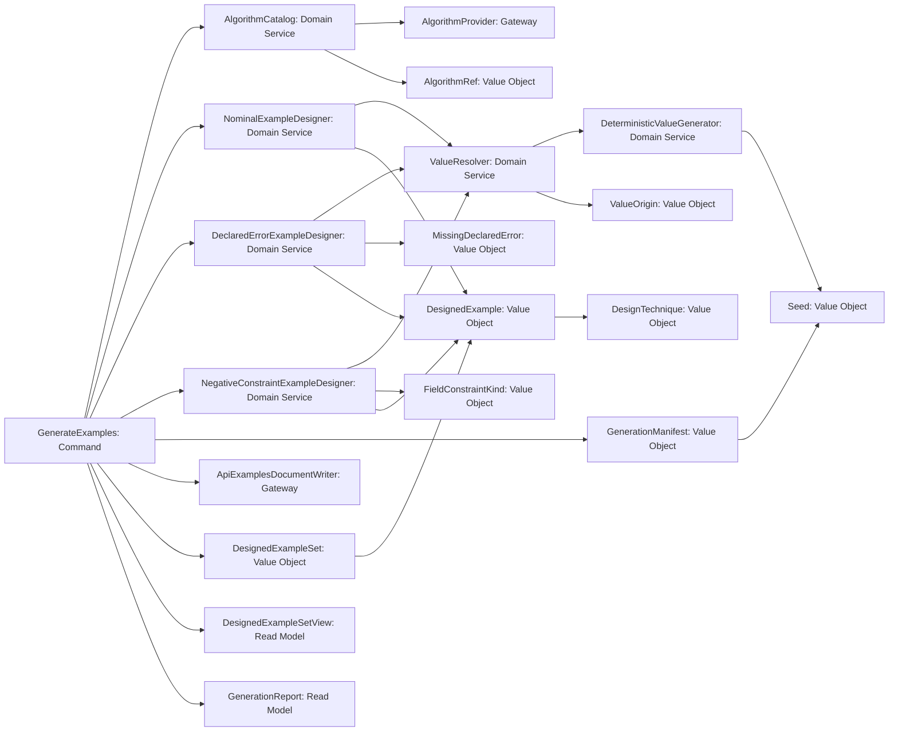

<!-- markdownlint-disable-file -->
# Tactical design — Test design (`design`)

Core subdomain. Packages: `domain.design` (`.examples`, `.catalog`), `application.design`
(`ARCHITECTURE.md` § Code organization). Event model:
[../domain/event-model/design.md](../domain/event-model/design.md).

## Aggregates

None. Designing examples is a pure function of its inputs — contract revision, team context
snapshot, seed and algorithm catalogue — and keeps no state between requests, so there is no
identity whose successive changes an invariant must span (`ARCHITECTURE.md` § Guiding decisions,
§ Rejected aggregates). Everything this context produces is reviewed and stored as a `Proposal`,
which is the aggregate of another context. The rules live in self-validating value objects and in
domain services named after the algorithm catalogue, never in an anaemic holder.

## Value objects

| Value object | Holds | Rejects at construction |
|---|---|---|
| `Seed` (`domain.shared`) | the team's seed, the only source of variation in a generation | an absent or non-numeric seed |
| `AlgorithmRef` (`domain.shared`) | an algorithm identifier and its version, such as `generators.format` v1 | a blank identifier, a missing version |
| `ValueOrigin` (`domain.shared`) | where one field's value came from, in the resolution order of the PRD: contract, Gherkin examples, team dictionary, promoted memory, deterministic generator, AI | an unknown origin, a generator origin with no `AlgorithmRef` |
| `DesignTechnique` | the named technique that produced an example: `Nominal`, `DeclaredError`, `NegativeConstraint` | any other value |
| `FieldConstraintKind` | which constraint a negative example violates: `Type`, `Format`, `Pattern`, `Required` | any other value |
| `DesignedExample` | an `OperationKey`, an example name, its `DesignTechnique`, the status code of the response it is attached to, its `AlgorithmRef`, the `ValueOrigin` of every field, and for a negative example the constraint it violates or the field it omits | a `NegativeConstraint` example with neither a violated constraint nor an omitted field; a `DeclaredError` or `NegativeConstraint` example attached to a status code the contract does not declare; a value with no origin |
| `DesignedExampleSet` | the first-class collection of designed examples of one contract revision | two examples with the same operation, technique and name |
| `GenerationManifest` | every input of one generation: contract revision hash, team context snapshot hash, seed, and the algorithm references in their deterministic order (`ARCHITECTURE.md` § Reproducibility) | a missing seed, an empty algorithm list |
| `MissingDeclaredError` | an operation whose contract declares no error response | a blank `OperationKey` |

The technique labels a person reads (`nominal`, `declared error`) are the rendering of
`DesignTechnique` through the message files; the vocabulary itself is this value object, and each
designed example also cites the versioned algorithm that produced its values, which is what makes
a generation explainable.

## Domain services

Pure and deterministic: no clock, no randomness, no input or output, seed taken as an argument
(`CONTRIBUTING.md` § Where code belongs, rule `R5` at `ARCHITECTURE.md` § Planned architecture
rules).

| Domain service | What it decides |
|---|---|
| `AlgorithmCatalog` | the algorithms available to a generation, built once at start from the descriptors the infrastructure read; refuses two algorithms with the same identifier and version (`ARCHITECTURE.md` § Extension points and plugins) |
| `ValueResolver` | which source wins for each field, in the resolution order of the PRD, and records the `ValueOrigin` it used |
| `DeterministicValueGenerator` | the value of a field with no declared or dictionary value, derived from the seed, the field path and the `AlgorithmRef`, so the same inputs give the same value (`ARCHITECTURE.md` § Extension points and plugins) |
| `NominalExampleDesigner` | one example per operation against its declared success response |
| `DeclaredErrorExampleDesigner` | one example per declared error response of an operation, and the `MissingDeclaredError` of an operation that declares none — it never invents an error response |
| `NegativeConstraintExampleDesigner` | one negative example per declared field constraint, attached to a declared error response of the operation |

## Domain events

None. Nothing of this context changes state: a generation reads its inputs, computes and keeps
nothing, so there is no fact of its own to record. The observable fact of a generation is
`ProposalSubmitted`, raised where the outcome is stored — the `Proposal` aggregate root of the
Proposal and decision context, reached through its open host service. That event is the recorded
successful outcome of `GenerateExamples`, and a generation that produced nothing storable produced
no fact.

The ratified `ExamplesGenerated` of this context (`ARCHITECTURE.md` § Domain events) has Coverage
as its only consumer. Coverage is not part of this slice set and no acceptance criterion observes
the event; what links a manifest to a proposal here is the manifest hash the proposal carries. The
event arrives with the slice that builds Coverage.

## Repositories

None: this context owns no aggregate, so it owns no repository.

## Gateways

In `application.design.port` (`CONTRIBUTING.md` § Where code belongs), implemented in the
infrastructure layer.

| Interface | Layer | What it asks | Evolution rule |
|---|---|---|---|
| `AlgorithmProvider` | Application | the algorithm descriptors available on this instance — each an identifier, a version and the technique it serves — read once at start | additions only; an unknown descriptor field is ignored |
| `ApiExamplesDocumentWriter` | Application | the APIExamples document of a designed set, rendered at its output path, with the same bytes for the same set | additions only |

The descriptors of this slice set are those of the built-in generators. The enterprise plugin
contract and its discovery (`ARCHITECTURE.md` § Extension points and plugins) are read through this
same gateway when their story arrives; nothing of them is built here, so no story of this slice set
depends on a plugin.

`ApiExamplesDocumentWriter` is where byte stability is produced: the adapter fixes the key order
and the serialisation of the artefact, and the domain fixes the values. Both are needed for the
same inputs to give the same bytes, and the proof is a reference-output test run as separate
processes (`ARCHITECTURE.md` § Reproducibility, `CONTRIBUTING.md` § Domain changes). The output path
follows the PRD's `examples/<api>-<version>.examples.yaml`.

## Contracts this context calls

Another context is reached only through its `api` package (rule `R2` at `ARCHITECTURE.md` § Planned
architecture rules):

| Contract called | What this context asks for |
|---|---|
| `application.contract.api` | the operations of the contract revision with their declared responses and their field constraints |
| `application.teamcontext.api` | the team context snapshot that carries the seed |
| `application.space.api` | `FindSpaceMembership` for the caller, before anything is read or designed |
| `application.proposal.api` | `SubmitProposal`, to put what was designed in front of a person |

Being the Core downstream, this context adopts no upstream shape. `application.design` holds its
anticorruption layer: it translates the `ContractOperationList` of Contract governance — its
operation, response and field-constraint views — into this context's own values before any designer
runs: the `OperationKey` of the shared kernel, the declared status codes a `DesignedExample` may
attach to, and `FieldConstraintKind`. The `TeamContextView` published by Team context is translated
in the same anticorruption layer into `Seed` and the dictionary values the `ValueResolver` reads.
No view type of another context reaches a domain service, and the designers know nothing of OpenAPI.

This context publishes nothing: no story of this slice set names a consumer of what it designs, and
what it produces is read through the `Proposal` it submits. A published package of its own arrives
with the first story that names a consumer for it.

## Component diagram

`DesignedExampleSet` is the value object the designers build; `DesignedExampleSetView` is the same
set rendered for a reader, with the technique, the algorithm and the value origins of each example.
