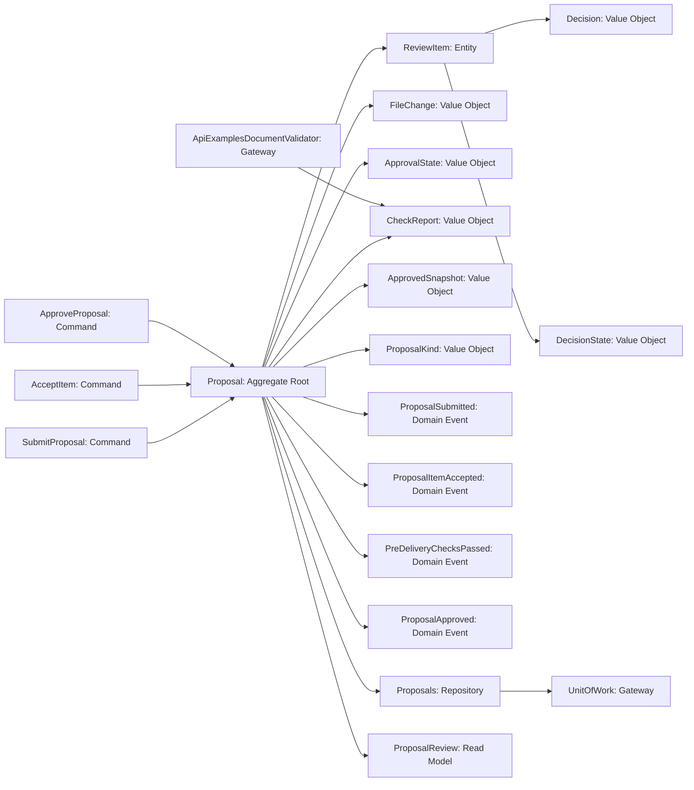

<!-- markdownlint-disable-file -->
# Tactical design — Proposal and decision (`proposal`)

Supporting subdomain. Package `io.microcks.foundry.<layer>.proposal`, as `ARCHITECTURE.md` § Code
organization decides. Event model:
[../domain/event-model/proposal.md](../domain/event-model/proposal.md).

## Reuse

| Element | Classification | Basis |
| --- | --- | --- |
| `Proposal` aggregate, its root, its contents and its approval invariants | reuse as specified | `ARCHITECTURE.md` § `Proposal` — Proposal and decision; no code exists yet, so the first slice writes it as specified |
| Open host service as the single entry point to human decision | reuse as specified | `ARCHITECTURE.md` § Context map and § Code organization (`application.proposal.api`) |
| `TeamSpaceId`, `ManagedApiId`, `AlgorithmRef`, `ValueOrigin` | reuse as-is | shared kernel of `ARCHITECTURE.md` § Code organization |
| `ProposalKind`, `DecisionState`, `ApprovalState`, `CheckName` | create new | the architecture names the kinds and the decisions in prose; these slices need them as values |

## Aggregate

### `Proposal` — root `ProposalId`

- Consistency boundary: one reviewed set of files for one API and version, with its review items,
  their decisions, its check report and its approved snapshot. One transaction changes one
  proposal, as `ARCHITECTURE.md` § Guiding decisions requires.
- Root holds: `ProposalId`, `TeamSpaceId`, `ManagedApiId`, `ProposalKind`, the revision number.
- Inside the boundary: `ReviewItem` (entity, identified by `ReviewItemId` inside the proposal),
  `FileChange`, `Decision`, `CheckReport`, `ApprovedSnapshot`.
- Invariants the current slices enforce:
  - approval requires a decision on every review item and a check report that passed on the
    current revision; an approval attempt with a pending item is refused and names how many items
    are pending;
  - any change to an item, a decision or a file creates a new revision, invalidates the check
    report and withdraws approval;
  - approval freezes an `ApprovedSnapshot` that excludes rejected items; nothing is delivered
    from anything else;
  - every review item carries its technique, its algorithm reference and the origin of each of
    its values; an item without provenance cannot exist.
- The invariants of later tranches (secret detection, AI file marking, automatic decisions,
  breaking-change version suggestion) stay in `ARCHITECTURE.md` § `Proposal` — Proposal and
  decision and are not restated here.
- References other aggregates by identity only (`TeamSpaceId`, `ManagedApiId`).
- Size: bounded to one examples file per API and version. `ReviewItem` becomes its own aggregate
  only once concurrent review proves to conflict, as the architecture already states.

## Entities

| Entity | Identity | Why it is an entity, not a value |
| --- | --- | --- |
| `ReviewItem` | `ReviewItemId`, unique inside its proposal | its decision state changes over the life of the proposal, and the pending-item rule is enforced across those successive changes |

## Value objects

| Value object | Holds | Validated at construction |
| --- | --- | --- |
| `FileChange` | the path, the diff and the reasons of the change | the path is relative to the team repository; at least one reason |
| `Decision` | the verdict, the author (a member or a team rule) and the time | the author is present; the time is an input, never read from a clock |
| `DecisionState` | one of `Pending`, `Accepted`, `Corrected`, `Rejected` | the value is known |
| `ApprovalState` | one of `NotApproved`, `Approved` | the value is known |
| `CheckReport` | the revision it was computed on and the result of each check | it names the revision; a report of another revision is never read as current |
| `CheckName` | one of the pre-delivery checks the current slices run: `ApiExamplesSchemaValid`, `OperationKeysMatchContract` | the value is known |
| `ApprovedSnapshot` | the approved revision and the content hash of each file to deliver | it holds no rejected item; it is never rebuilt once frozen |
| `ProposalKind` | `Examples` for the current slices | the value is known |

## Domain events

Raised by the `Proposal` root, past tense, identities only:

- `ProposalSubmitted`, `ProposalItemAccepted`, `PreDeliveryChecksPassed`, `ProposalApproved`.

A refused approval raises no event: it changes no state. The events are dispatched synchronously
after commit, as `ARCHITECTURE.md` § Domain events decides for this tranche.

## Repositories

| Interface | Aggregate | Layer |
| --- | --- | --- |
| `Proposals` | `Proposal` | Application, package `application.proposal.port` |

Layer rule as in [contract.md](contract.md) § Repositories. Every method is scoped by
`TeamSpaceId`; writes go through the shared `UnitOfWork` port.

Durability: no acceptance criterion of the current stories requires proposal state to survive a
restart or to be read concurrently, so these slices keep the store behind `Proposals` and pick no
database. The persistence adapter is chosen by the first story that states a durability or
concurrency requirement, in `infrastructure.persistence.proposal`.

## Gateways

| Interface | Outside dependency | What it asks, in business terms | Layer |
| --- | --- | --- | --- |
| `ApiExamplesDocumentValidator` | the APIExamples `v1alpha1` schema validator | "is this examples document valid against the published APIExamples schema, and if not, where is it wrong?" | Application, `application.proposal.port` |
| `UnitOfWork` | the transaction manager of the store | "commit this aggregate and its journal entries as one unit, or none of them" | Application, `application.shared.port`; the one shared interface of `ARCHITECTURE.md` § Domain events, used by every context that writes |

## Interfaces this context publishes

`application.proposal.api` is the open host service: upstream contexts call `SubmitProposal` and
read nothing else of this context. Evolution rule: additions only — a new `ProposalKind`, a new
check or a new review-item field never changes the meaning of the existing ones, and a submitter
that does not know a field omits it. The Delivery context consumes `ProposalApproved` and the
approved snapshot it names, nothing more.

## Components

