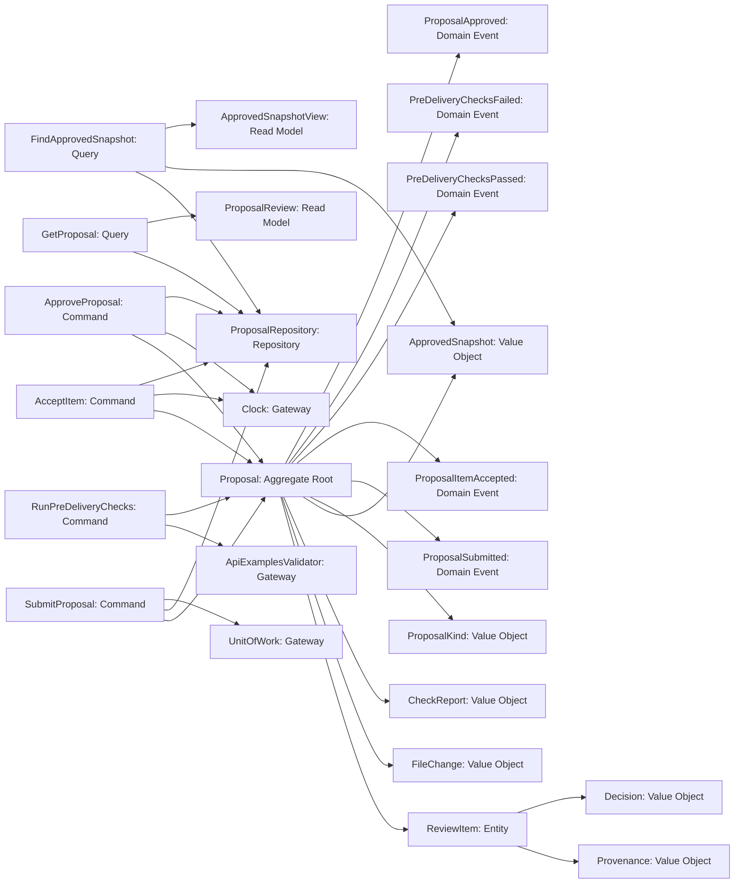

<!-- markdownlint-disable-file -->
# Tactical design — Proposal and decision (`proposal`)

Supporting subdomain. Packages: `domain.proposal`, `application.proposal`
(`ARCHITECTURE.md` § Code organization). Event model:
[../domain/event-model/proposal.md](../domain/event-model/proposal.md).

## Aggregates

### `Proposal` — Aggregate Root

- **Root and identity:** `ProposalId`, inside the `TeamSpaceId` of its space, with its revision
  number (`ARCHITECTURE.md` § Aggregates).
- **Consistency boundary:** one reviewed set of files for one API and version, with the decision of
  every item, the check report of the current revision and, once approved, the frozen snapshot.
  These must change together: a decision, a check result and an approval are meaningless against
  different revisions, and each decision, each check run and each approval is a successive change of
  the same identity that the next one depends on. This is the one invariant of this slice set that
  spans the life of an identity, which is why this context has an aggregate and the others do not.
- **Contains:** `FileChange`, `ReviewItem` with its `Provenance` and its `Decision`, `CheckReport`,
  `ApprovedSnapshot`.
- **Invariants this slice set exercises** (the complete ratified list is `ARCHITECTURE.md`
  § Aggregates):
  - approval requires a decision on every item and a passing check report on the current revision;
  - any change to an item, a decision or the description opens a new revision, invalidates the
    check report and withdraws approval;
  - approval freezes an `ApprovedSnapshot` of the files to deliver, and a delivery only ever uses
    that snapshot; a rejected item is excluded from it;
  - a refused approval changes nothing: it is an error result of the command, not a revision. The
    review read model reports it as `Approved` no with a `RefusalReason` — the state under its own
    domain name, the refusal under the one name every read model of the project uses
    (`CONTRIBUTING.md` § Naming).
- **References by identity only:** `TeamSpaceId`, `ManagedApiId`.
- **Size:** bounded to one examples file per API and version. `ReviewItem` becomes its own
  aggregate only once concurrent review is shown to conflict (`ARCHITECTURE.md` § Aggregates);
  nothing in this slice set shows that, so it stays inside.
- **Raises:** `ProposalSubmitted`, `ProposalItemAccepted`, `PreDeliveryChecksPassed`,
  `PreDeliveryChecksFailed`, `ProposalApproved`.

`ReviewItem` is the one entity inside the aggregate: it has an identity the reviewer decides on and
its decision changes over the proposal's life. Everything else it holds is a value object.

## Value objects

| Value object | Holds | Rejects at construction |
|---|---|---|
| `ProposalId` | the proposal identity | a blank value |
| `ProposalKind` | what the proposal is about; `Examples` in this slice set | any value outside the ratified list (`ARCHITECTURE.md` § Aggregates) |
| `FileChange` | the path of a file, its diff and the reason of each change | a blank path, a change with no reason |
| `Provenance` | for a generated item, its `AlgorithmRef`, its `DesignTechnique` and the `ValueOrigin` of each value; for a human edit, its author | a generated item with no algorithm reference; an item with both an algorithm and a human author |
| `Decision` | a verdict — `Pending`, `Accepted`, `Corrected` or `Rejected` — its author and its time | a decided verdict with no author or no time |
| `CheckReport` | the revision it was computed on, each check result and the findings | a report with no revision |
| `ApprovedSnapshot` | the approved revision and, for every file to deliver, its path, the content frozen at approval and its content hash | an empty file list, a file with no content or no content hash |

The content, not only its hash, is frozen in the snapshot: that is what lets a delivery produce
exactly the approved bytes however the proposal moves on afterwards.

## Domain events

| Event | Payload | Consumers |
|---|---|---|
| `ProposalSubmitted` | identities, kind, revision, item count, the generation manifest hash when the items were generated | decision journal |
| `ProposalItemAccepted` | identities, the item, the revision, the author and the time | decision journal |
| `PreDeliveryChecksPassed` | identities and the revision — a passing report has no finding to count | decision journal |
| `PreDeliveryChecksFailed` | identities, the revision and the finding count | decision journal |
| `ProposalApproved` | identities, the revision, the author, the time and the snapshot hash | Delivery, decision journal (`ARCHITECTURE.md` § Domain events) |

Every event carries identities only, never an item or a file. Coverage and the other ratified
consumers of these events (`ARCHITECTURE.md` § Domain events) are not part of this slice set.

## Repositories

| Interface | Layer | Why there |
|---|---|---|
| `ProposalRepository` | Domain (`domain.proposal`) | it returns the `Proposal` aggregate whole and guards its invariants; by the stack rule a repository that persists an aggregate belongs to the Domain layer. Every read is scoped by `TeamSpaceId`. |

These stories need no durable store: the implementation is an in-memory one in
`infrastructure.persistence.proposal`, and the durable adapter belongs to the story that requires
survival across restarts.

## Gateways

| Interface | Layer | What it asks | Evolution rule |
|---|---|---|---|
| `ApiExamplesValidator` | Application (`application.proposal.port`) | whether a proposed examples document conforms to the published APIExamples schema, and what is wrong when it does not | additions only; a new finding kind is additive |
| `Clock` | Application (`application.shared`) | the current instant, so that a decision can be dated without the domain reading a clock (rule `R5` at `ARCHITECTURE.md` § Planned architecture rules) | none needed |
| `UnitOfWork` | Application (`application.shared`) | commit one aggregate and its journal entries atomically (`ARCHITECTURE.md` § Domain events, Transactions) | additions only |

## Contracts this context calls

`application.contract.api` for the operation keys of the contract revision, so the pre-delivery
checks can tell that every key of the proposed document matches the contract. That is a read of
another context's published language, not a gateway, and it is declared on
[context-map.md](context-map.md). `application.space.api` answers `FindSpaceMembership` for the
caller before any command or query of this context is served.

## Published contract for other contexts

`application.proposal.api` is the open host service every upstream context uses to reach the human
decision (`ARCHITECTURE.md` § Context map).

| Published element | Layer | Inputs | Outcome |
|---|---|---|---|
| `SubmitProposal` | Application (`application.proposal.api`) | the space, the API, the kind, the author, the files and the review items with their provenance | the proposal identity at revision 1 |
| `ProposalApproved` (integration event) | Application (`application.proposal.api`) | — | identities, the approved revision, the author, the time and the snapshot hash |
| `FindApprovedSnapshot` | Application (`application.proposal.api`) | `TeamSpaceId`, `ProposalId`, `RequestedBy: MemberId` | `ApprovedSnapshotView`: `Accepted` — whether an approved snapshot is handed over — the approved revision, the snapshot hash and, for every file, its path, its content and its content hash; `RefusalReason` when the proposal is not approved. The caller is named because this context checks membership for it before it answers, as it does for every command and every query of its own |

| Consumer | What it needs from this contract |
|---|---|
| Test design | `SubmitProposal`, to put a designed set in front of a person |
| Delivery | `ProposalApproved` to know an approval happened, and `FindApprovedSnapshot` to obtain the very files and hashes it must write, which it copies into entries of its own — a delivery exists only for an approved snapshot (`ARCHITECTURE.md` § Context map), and it never reads this context's repository |

It grows by addition only; a reader ignores a field it does not know, and no caller may reach a
handler or a repository of this context directly (rule `R2` at `ARCHITECTURE.md` § Planned
architecture rules).

`PullRequestDescription`, the automatic decision policy and the secret and compatibility checks are
part of the ratified aggregate but belong to the slices that introduce a pull request, a team rule
or a contract change; this slice set adds none of them.

## Component diagram

