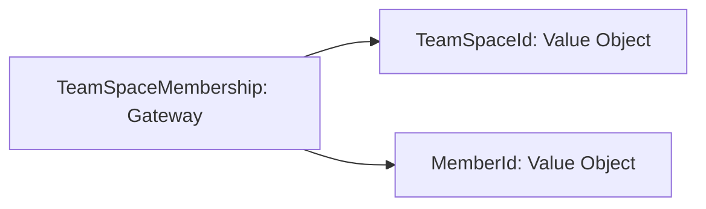

<!-- markdownlint-disable-file -->
# Tactical design — Team spaces (`space`)

Generic subdomain. Package `io.microcks.foundry.<layer>.space`, as `ARCHITECTURE.md` § Code
organization decides. This context has no slice of its own in the current stories: no command
creates or changes a team space here. It supplies the shared kernel identity every other context
is scoped by, and the membership answer the use cases check, which is why it has no event model
file.

## Reuse

| Element | Classification | Basis |
| --- | --- | --- |
| `TeamSpace` aggregate and its invariants (export token, enabled AI providers, retention) | reuse as specified, not exercised | `ARCHITECTURE.md` § `TeamSpace` and `AiProviderCatalog` — Team spaces; no command of these slices changes it |
| `TeamSpaceId` as the shared kernel identity | reuse as-is | `ARCHITECTURE.md` § Context map (Shared Kernel) and `CONTRIBUTING.md` § Where code belongs (`TeamSpaceId` on every aggregate) |
| `MemberId` and the membership answer | create new | the stories need the caller's identity to scope every read and write; the standalone mode authenticates with OIDC, the embedded mode reuses the host session |

## Aggregates

None exercised. `TeamSpace` stays as the architecture specifies it; the current stories presuppose
that two spaces exist and never change one, so these slices add no command to it and no repository
for it. The first story that creates or configures a space writes `TeamSpaces` next to it.

## Value objects

| Value object | Holds | Validated at construction |
| --- | --- | --- |
| `TeamSpaceId` | the identity of one team space | shared kernel; not empty |
| `MemberId` | the identity of one authenticated member | not empty; it is the subject the identity provider gave, never a display name |

## Team-space scope

The isolation requirement is the PRD's (`§ 11 Isolation`) and `ARCHITECTURE.md` states its shape:
`TeamSpaceId` is the shared kernel, every aggregate carries it, a command is rejected when its
author does not belong to the team space, and a query answers for one space. This section states
how that holds for reads as well as writes, for every context of this repository:

1. Every command and every query carries the caller's `TeamSpaceId` and `MemberId`.
2. The use case checks membership through `TeamSpaceMembership` before it reads or writes
   anything, and refuses without disclosing whether the named thing exists elsewhere.
3. Every repository and gateway method takes the `TeamSpaceId` it answers for; none offers a
   method that answers across spaces. A read of another space is therefore not expressible, which
   is what the isolation scenarios observe.
4. An architecture rule and its counter-example test are added with the slice, so a method that
   omits the scope fails the build instead of relying on review.

## Gateways

| Interface | Outside dependency | What it asks, in business terms | Layer |
| --- | --- | --- | --- |
| `TeamSpaceMembership` | the identity provider in standalone mode, the embedding host's session when integrated | "does this member belong to this team space?" | Application, `application.space.port` |

Layer rule as in [contract.md](contract.md) § Repositories. The gateway is the anti-corruption
layer of this context: no token, claim or session type reaches the application or the domain,
only `MemberId` and `TeamSpaceId`.

## Interfaces this context publishes

`TeamSpaceId` and `MemberId` are the shared kernel every context depends on. Evolution rule for a
shared kernel: additions only, and a change to either identity is a change every context shares,
so it is made once here.

## Components

