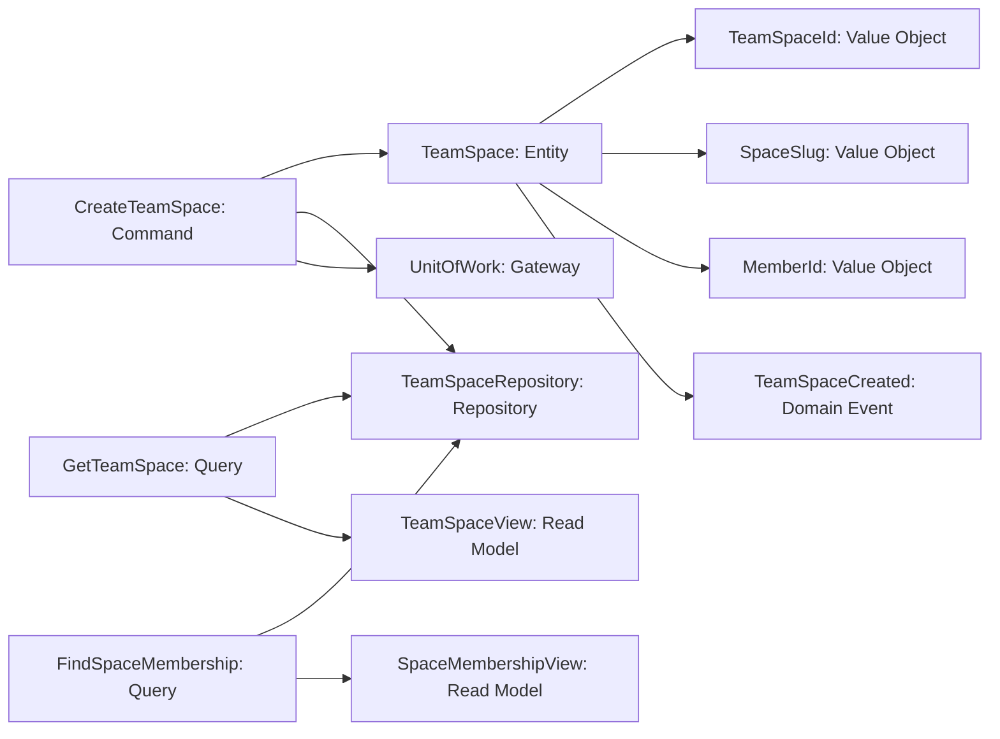

<!-- markdownlint-disable-file -->
# Tactical design — Team spaces (`space`)

Generic subdomain, and the shared kernel of every other context. Packages: `domain.space`,
`domain.shared`, `application.space` (`ARCHITECTURE.md` § Code organization). Event model:
[../domain/event-model/space.md](../domain/event-model/space.md).

## Aggregates

None in this slice set.

An aggregate of the target model becomes one in the code only once a slice gives it an invariant to
hold across the successive or concurrent changes of one identity (`ARCHITECTURE.md` § Aggregates).
A space is created once with its slug, its display name and its members, and no story of this slice
set changes any of them. The uniqueness of a slug spans different spaces, not the successive
changes of one space, so it is a storage constraint rather than an invariant a transaction boundary
protects; "at least one member" is checked at the single construction. No invariant is left that
must hold across successive or concurrent changes of one identity, so the space is a
self-validating entity.

The export token, the retention window, the Microcks connection, the target repositories and the
selected AI providers are part of the ratified `TeamSpace` aggregate (`ARCHITECTURE.md`
§ Aggregates) and arrive with the slices that change them; those changes are what will make it an
aggregate.

### `TeamSpace` — Entity

- **Identity:** `TeamSpaceId`.
- **Holds:** its `SpaceSlug`, its display name and its members.
- **Validated at construction:** a well-formed slug, a non-blank display name, at least one member.
- **References by identity only:** `MemberId`.
- **Raises:** `TeamSpaceCreated`, the fact of its single creation.
- **Set rule, not an invariant of this entity:** a slug designates exactly one space on the
  instance — a constraint of the store the repository relies on.
- **Rule every other context applies:** a space answers only to its own members; a request whose
  author is not a member is refused before anything else is read or written
  (`ARCHITECTURE.md` § Commands, PRD §11 Isolation). That refusal is made by the caller, on the
  answer of the published membership read below.

## Value objects

| Value object | Holds | Rejects at construction |
|---|---|---|
| `TeamSpaceId` (`domain.shared`) | the identity every other stored identity carries | a blank value |
| `SpaceSlug` | the name a person uses for the space | an empty slug, a slug with a character outside the allowed set |
| `MemberId` (`domain.shared`) | the identity of a person acting on the instance | a blank value |

`TeamSpaceId` is the shared kernel, with `ManagedApiId`, `OperationKey` and `AlgorithmRef`: every
stored identity of every context carries it and every read is scoped by it (`ARCHITECTURE.md`
§ Context map, `CONTRIBUTING.md` § Where code belongs). This is what makes one team's dictionaries,
examples and proposals invisible to another.

## Domain events

| Event | Payload | Raised by | Consumers |
|---|---|---|---|
| `TeamSpaceCreated` | the space identity, its slug and the member who created it — identities only, and no time, since nothing of this slice set dates the fact and the domain reads no clock (rule `R5` at `ARCHITECTURE.md` § Planned architecture rules) | the `TeamSpace` entity, when it is created | none in this slice set |

Creating a space is the successful outcome of a business command, so it is recorded as a domain
event even though this context holds no aggregate root yet: a write-once entity records the fact of
its creation (`ARCHITECTURE.md` § Aggregates). The event carries identities only, never the entity.
Its ratified consumers — Traffic observation and Test design (`ARCHITECTURE.md` § Domain events) —
are not part of this slice set, and no acceptance criterion observes the event: what the stories
observe is `TeamSpaceView`. The token and provider events belong to the slices that issue a token
or administer a provider.

## Repositories

| Interface | Layer | Why there |
|---|---|---|
| `TeamSpaceRepository` | Application (`application.space.port`) | `TeamSpace` is an entity with no invariant to guard across successive changes, so by the stack rule its repository is an Application-layer contract rather than a Domain one. It stores and returns a space by identity or by slug, and refuses a duplicate slug through its storage constraint. |

In-memory in `infrastructure.persistence.space` for these stories.

## Gateways

| Interface | Layer | What it asks | Evolution rule |
|---|---|---|---|
| `UnitOfWork` | Application (`application.shared`) | commit one write and its journal entries atomically | additions only |

No gateway establishes who the caller is: the entry point translates the authenticated identity
into a `MemberId` before it builds a command or a query — an OIDC identity when Foundry runs on its
own, the host's session when it is embedded in Microcks. The domain never reads a token.

## Published contract for other contexts

`application.space.api` is the open host service every other context calls. It publishes two reads
and nothing else; no caller reaches a handler or the repository of this context (rule `R2` and rule
`R9`, `ARCHITECTURE.md` § Planned architecture rules).

| Published read | Layer | Inputs | Outcome |
|---|---|---|---|
| `FindSpaceMembership` | Application (`application.space.api`) | `TeamSpaceId`, `MemberId` | `SpaceMembershipView`: the two identities it was asked about and `Member: yes/no`. A space that does not exist and a person who is not one of its members give the same answer, `no`, so that nothing leaks about another team's spaces. |
| `GetTeamSpace` | Application (`application.space.api`) | `RequestedBy: MemberId`, an optional slug | `TeamSpaceView`, which reports the outcome of the read under the names `CONTRIBUTING.md` § Naming fixes: `Accepted` yes with the space and its members when the caller belongs to it, `Accepted` no with a `RefusalReason` otherwise. A space that does not exist and a space the caller is not a member of give the same refusal, word for word, so that nothing leaks about another team's spaces |

`FindSpaceMembership` is the read every other context calls before it answers; a `no` is what makes
a command or a query of another context refusable before it runs. It grows by addition only: a
reader ignores a field it does not know, and no field is removed or narrowed.

## Component diagram

