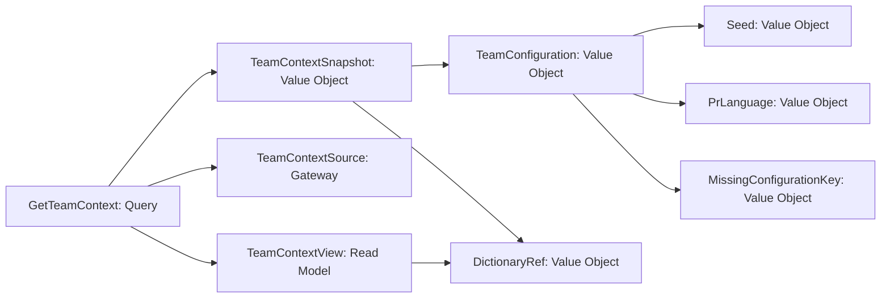

<!-- markdownlint-disable-file -->
# Tactical design — Team context (`teamcontext`)

Supporting subdomain. Packages: `domain.teamcontext`, `application.teamcontext`
(`ARCHITECTURE.md` § Code organization). Event model:
[../domain/event-model/teamcontext.md](../domain/event-model/teamcontext.md).

## Aggregates

None in this slice set. The team's git repository is the source of truth for `.foundry/`
(`ARCHITECTURE.md` § Guiding decisions), so this context holds no state of its own to protect: it
reads a revision and hands out an immutable snapshot. `MemoryCandidate`, the one aggregate the
ratified model gives this context, exists only for learned values and their promotion
(`ARCHITECTURE.md` § Bounded contexts, § Aggregates), which no story here needs.

## Value objects

| Value object | Holds | Rejects at construction |
|---|---|---|
| `Seed` (`domain.shared`) | the team's seed, the only source of variation in a generation | an absent or non-numeric value |
| `PrLanguage` | the language of the pull requests of the team: `fr` or `en` | any other value |
| `TeamConfiguration` | what `.foundry/config.yaml` states for the space: its `Seed` and its `PrLanguage` | a configuration with no seed, with a `MissingConfigurationKey` outcome naming the configuration file and the key `seed` |
| `MissingConfigurationKey` | the configuration file that was read and the key it does not hold | a blank file or key |
| `DictionaryRef` | the name of a dictionary of the space and how many entries it holds | a blank name, a negative count |
| `TeamContextSnapshot` | one immutable reading of a team's context: the source revision, its `TeamConfiguration`, its `DictionaryRef` list, and the content hash of the whole | a snapshot with no source revision; a snapshot whose configuration was refused |

Refusing a configuration with no seed is a construction rule of `TeamConfiguration`: it is checked
once, so it belongs to the self-validating value object rather than to an aggregate or a service.
The file name comes from the reading, the key from the domain, and the sentence a person reads is
assembled from the message files.

`TeamContextSnapshot` computes its own content hash from its content, which is what a
`GenerationManifest` pins so that the same context gives the same bytes (`ARCHITECTURE.md`
§ Reproducibility).

## Domain events

None in this slice set: nothing changes state here, and this context holds no aggregate root. The
events of this context (`ValueLearned`, `LearnedValueConfirmed`, `MemoryPromotionProposed`,
`ARCHITECTURE.md` § Domain events) belong to the memory slices.

## Repositories

None: this context owns no aggregate in this slice set, so it owns no repository.

## Gateways

| Interface | Layer | What it asks | Evolution rule |
|---|---|---|---|
| `TeamContextSource` | Application (`application.teamcontext.port`) | the `.foundry/` content of a space as it stands at its current revision: the configuration entries, the dictionaries with their entry counts, the revision read and the path of the configuration file | additions only; an entry the domain does not know is ignored |

The anticorruption layer is in the adapter (`infrastructure.github`, `infrastructure.yaml`): it
reads the files at a revision and hands over plain entries. No file format, no git type and no YAML
type crosses into `application` or `domain` (rule `R8`, `ARCHITECTURE.md` § Planned architecture
rules). Where a space's `.foundry/` content lives is the adapter's business, not this context's:
the gateway is asked for the content of a space, by its identity. The key names of the
configuration file — `seed`, `prLanguage` — are the adapter's reading of the story's configuration;
the domain knows them as `Seed` and `PrLanguage`.

## Contracts this context calls and publishes

It calls `application.space.api` for one thing only, `FindSpaceMembership` for the caller, and
never reads the storage of that context (rule `R2` and rule `R9`, `ARCHITECTURE.md` § Planned
architecture rules).

It publishes `application.teamcontext.api` with `GetTeamContext` (`ARCHITECTURE.md` § Queries): an
immutable, versioned snapshot for Test design, which needs the seed and the dictionaries for a
reproducible generation (`ARCHITECTURE.md` § Context map). It grows by addition only; a reader
ignores a field it does not know.

## Component diagram

