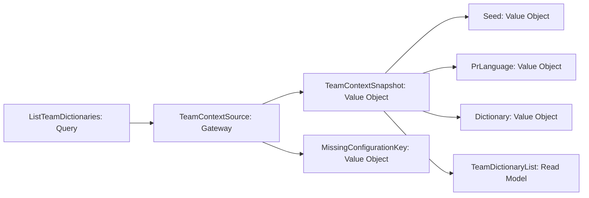

<!-- markdownlint-disable-file -->
# Tactical design — Team context (`teamcontext`)

Supporting subdomain. Package `io.microcks.foundry.<layer>.teamcontext`, as `ARCHITECTURE.md`
§ Code organization decides. Event model:
[../domain/event-model/teamcontext.md](../domain/event-model/teamcontext.md).

## Reuse

| Element | Classification | Basis |
| --- | --- | --- |
| `TeamContextSnapshot` as an immutable, revision-pinned value | reuse as specified | `ARCHITECTURE.md` § Context map (Customer/Supplier with Test design) and § Code organization |
| `Seed` | reuse as-is | shared kernel of `ARCHITECTURE.md` § Code organization |
| `MemoryCandidate` aggregate | not in these slices | `ARCHITECTURE.md` places it in a later tranche and makes it conditional |
| `PrLanguage`, `Dictionary`, `MissingConfigurationKey` | create new | the stories read the PR language and the dictionaries of a space, and refuse a generation naming the missing configuration key |

## Aggregates

None in these slices. The team's git repository is the source of truth for `.foundry/`: the
context reads it at a revision and holds no identity whose changes it must guard. A change to the
team context arrives as a proposal in a later tranche, so no aggregate is created here.

## Value objects

Immutable, equal by value, validated at construction.

| Value object | Holds | Validated at construction |
| --- | --- | --- |
| `TeamContextSnapshot` | `TeamSpaceId`, the source revision, `Seed`, `PrLanguage`, the dictionaries, the snapshot hash | the seed is present, so a snapshot without a seed cannot exist; the hash is derived from the other fields only |
| `PrLanguage` | one of `Fr`, `En` | the value is one of the two languages the product supports |
| `Dictionary` | the dictionary name and its entries | the name is unique inside a snapshot; an entry has a key and a value |
| `MissingConfigurationKey` | the configuration file name and the key that is missing from it | both are present and not empty |

Because `TeamContextSnapshot` cannot be built without a seed, the missing-seed refusal is decided
where the snapshot is asked for: the gateway yields either a snapshot or a
`MissingConfigurationKey`, and the generation use case refuses with a reason that names the file
and the key the gateway reported. No clock, no file access and no parser reaches the domain.

## Domain events

None in these slices: nothing in this context changes state, so there is no fact to record.

## Repositories

None: this context has no aggregate in these slices. The dictionaries and the configuration are
read through the gateway below, not through a repository, because they are read from the team
repository at a revision and never written here.

## Gateways

| Interface | Outside dependency | What it asks, in business terms | Layer |
| --- | --- | --- | --- |
| `TeamContextSource` | the team's git repository (`.foundry/config.yaml`, `.foundry/dictionaries/`) | "give me the context of this team space at its current revision: its seed, the language of its pull requests and its dictionaries — or the name of the configuration key that is missing" | Application, `application.teamcontext.port` |

Layer rule as in [contract.md](contract.md) § Repositories. Every method is scoped by
`TeamSpaceId`: the gateway never reads the `.foundry/` of another space
([space.md](space.md) § Team-space scope). The gateway is the anti-corruption layer of this
context: configuration key names and file formats live in its adapter, never in the domain.

## Interfaces this context publishes

`TeamContextSnapshot` is supplied to the Test design context (Customer/Supplier). Evolution rule:
additions only — a later tranche adds memory, rules and skills to the snapshot, and a consumer
that does not know a field ignores it. The snapshot hash covers every field, so adding one
changes the hash and therefore the generation manifest, which is what reproducibility requires.

## Components

