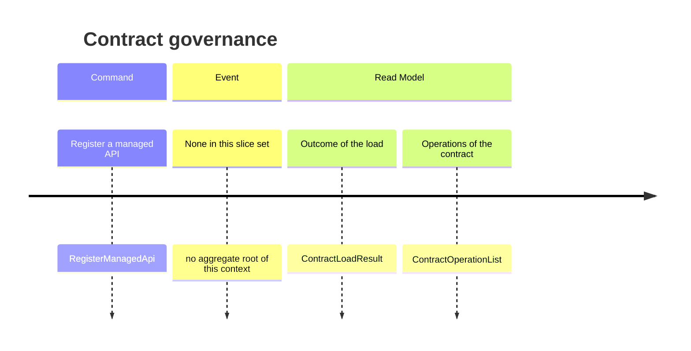

<!-- markdownlint-disable-file -->
# Event model — Contract governance (`contract`)

Scope of this slice set: attaching a REST contract to a team space, refusing a document that is not
OpenAPI 3.x, and publishing the operations, their declared responses and their field constraints as
the published language the Test design and the Proposal contexts read.

State changed by these slices: the registration of one API inside a space. It is a write-once
entity, not an aggregate root, so this context raises no domain event here
([../../architecture/contract.md](../../architecture/contract.md) § Aggregates, § Domain events).
A `ContractRevision` is a value object read from the source, never state this context owns.

The names below are the ones the skeleton and the code use. Rules are not restated here: the
acceptance scenarios hold them.

## Slice CG-1 — Attach a REST contract to the space

| Step | Kind | Name | Fields |
|---|---|---|---|
| 1 | Command | `RegisterManagedApi` | `TeamSpaceId: TeamSpaceId`, `RequestedBy: MemberId`, `ApiName: text`, `ApiVersion: text`, `ContractSourceRef: ContractSourceRef` |
| 2 | Read Model | `ContractLoadResult` | `Accepted: yes/no`, `ManagedApiId: ManagedApiId?`, `ApiName: text?`, `ApiVersion: text?`, `ContractRevisionHash: text?`, `DetectedFormat: ContractFormat`, `SupportedFormats: list of ContractFormat`, `RefusalReason: text?` |

Observed: `ContractLoadResult.Accepted`, `ContractLoadResult.RefusalReason` and
`ContractLoadResult.SupportedFormats` when the loaded document is not OpenAPI 3.x;
`ContractLoadResult.ManagedApiId` and `ContractLoadResult.ContractRevisionHash` when it is.

## Slice CG-2 — Publish the operations a generation designs from

| Step | Kind | Name | Fields |
|---|---|---|---|
| 1 | Query | `FindContractRevision` | `TeamSpaceId: TeamSpaceId`, `ManagedApiId: ManagedApiId`, `RequestedBy: MemberId` |
| 2 | Read Model | `ContractOperationList` | `ApiName: text`, `ApiVersion: text`, `ContractRevisionHash: text`, `Operations: list of OperationView` |
| 2a | Read Model | `OperationView` | `OperationKey: OperationKey`, `Summary: text?`, `SuccessResponse: ResponseView`, `DeclaredErrorResponses: list of ResponseView`, `FieldConstraints: list of FieldConstraintView` |
| 2b | Read Model | `ResponseView` | `StatusCode: whole number`, `Kind: one of Success \| ClientError \| ServerError`, `PayloadShape: text?` |
| 2c | Read Model | `FieldConstraintView` | `FieldPath: text`, `Kind: one of Type \| Format \| Pattern \| Required`, `Expectation: text` |

Observed: `ContractOperationList.Operations` — one entry per operation of the contract, each with
its `SuccessResponse`, its `DeclaredErrorResponses` (empty when the contract declares none) and its
`FieldConstraints`.

`FindContractRevision` is a pure read: it raises no event. `ContractOperationList` and the views it
carries are the published language of this context; they are extended by addition only, and a
reader ignores a field it does not know.

## Facts this slice set does not model as events

| Fact | Why not here |
|---|---|
| `ManagedApiRegistered` | The ratified event (`ARCHITECTURE.md` § Domain events) is consumed by Traffic observation, Divergences and Coverage, none of which exists in this slice set, and no acceptance criterion observes it. This context has no aggregate root here, and a fact recorded outside an aggregate is not a domain event. The registration is observed in `ContractLoadResult`. |
| `PrimarySourceDesignated`, `ContractUpdateModeChanged`, `ContractAudited` | Their commands (PRD E2.4, E2.13, E1.9) are out of this slice set. |
