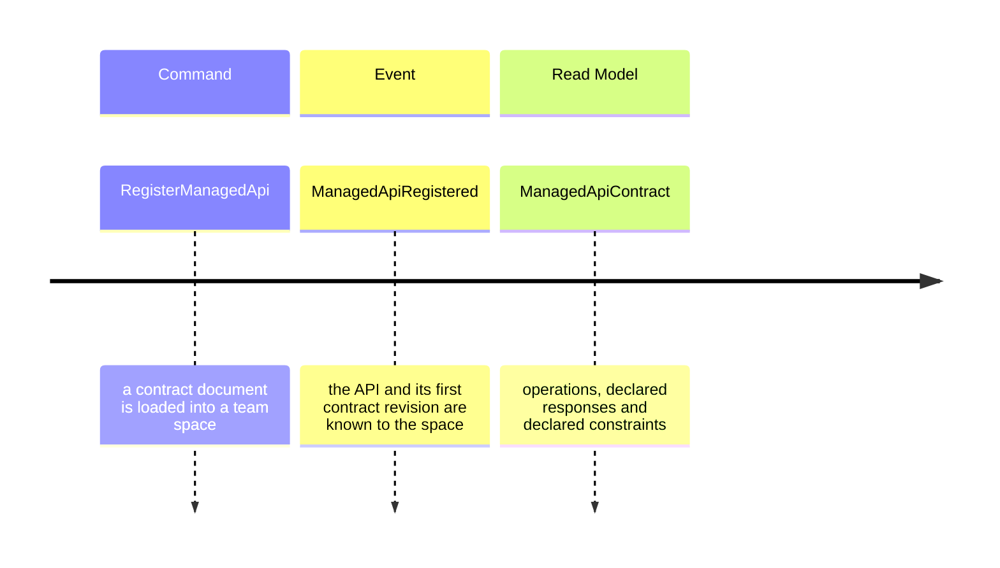

<!-- markdownlint-disable-file -->
# Event model — Contract governance (`contract`)

Slices of the current stories only. Names here are the ones the code, the scenarios and the
tactical design ([../../architecture/contract.md](../../architecture/contract.md)) use.

## Slice CG-1 — Load a contract document into a team space

Least deliverable value: a loaded REST contract whose operations can be read, and a refusal for a
contract format the product does not support.

| Step | Kind | Name | Fields |
| --- | --- | --- | --- |
| 1 | Command | `RegisterManagedApi` | `TeamSpaceId: TeamSpaceId`, `MemberId: MemberId`, `ContractSource: ContractSourceRef`, `ApiName: text?`, `ApiVersion: text?` |
| 2 | Domain Event | `ManagedApiRegistered` | `ManagedApiId: ManagedApiId`, `TeamSpaceId: TeamSpaceId`, `ApiName: text`, `ApiVersion: text`, `PrimarySource: ContractSourceRef`, `ContractFormat: ContractFormat`, `ContractHash: text` |
| 3 | Read Model | `ManagedApiContract` | `ManagedApiId: ManagedApiId`, `ApiName: text`, `ApiVersion: text`, `ContractHash: text`, `Operations: list of OperationKey`, per operation `DeclaredResponses: list of DeclaredResponse`, per operation `DeclaredConstraints: list of Constraint` |

`ApiName` and `ApiVersion` are read from the document when the command does not carry them.

Observed: `ManagedApiContract.Operations` (every operation of the reference contract) and, per
operation, the declared response schema a nominal example must conform to;
`ManagedApiContract.DeclaredResponses` and `ManagedApiContract.DeclaredConstraints`, including an
operation whose declared responses hold no error response. The refusal of `RegisterManagedApi`
for an unsupported contract format is also watched: it changes no state, raises no event, and its
reason names the supported REST contract format.

## Not a trigger of this context

Reading a contract revision during a generation is a step inside the Test design use case, not a
command of this context: the generation reads the published contract model of the registered API.
