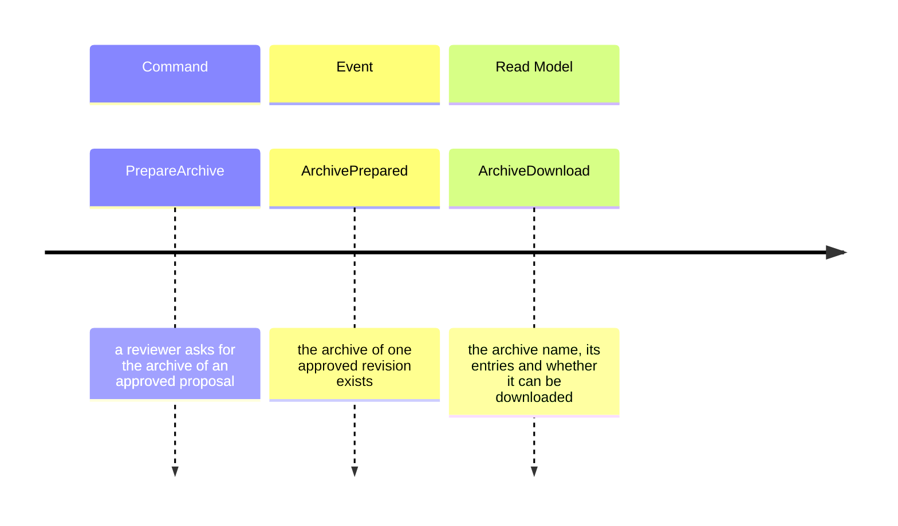

<!-- markdownlint-disable-file -->
# Event model — Delivery (`delivery`)

Slices of the current stories only. Names here are the ones the code, the scenarios and the
tactical design ([../../architecture/delivery.md](../../architecture/delivery.md)) use.

## Slice DL-1 — Download the approved examples as an archive

Least deliverable value: an archive built only from an approved snapshot, holding the examples
file the reviewer approved.

| Step | Kind | Name | Fields |
| --- | --- | --- | --- |
| 1 | Command | `PrepareArchive` | `TeamSpaceId: TeamSpaceId`, `ProposalId: ProposalId`, `ApprovedRevision: count`, `MemberId: MemberId`, `RequestedAt: date` |
| 2 | Domain Event | `ArchivePrepared` | `DeliveryId: DeliveryId`, `TeamSpaceId: TeamSpaceId`, `ProposalId: ProposalId`, `ApprovedRevision: count`, `Channel: Channel`, `ArchiveName: ArchiveName`, `ArchiveHash: text`, `PreparedAt: date` |
| 3 | Read Model | `ArchiveDownload` | `DeliveryId: DeliveryId`, `ArchiveName: ArchiveName`, `Entries: list of ArchiveEntry`, `Available: yes/no` |

Observed: `ArchiveDownload.Entries` holding the examples file of the API and version, valid
against the APIExamples `v1alpha1` schema, and `ArchiveDownload.Available` being yes only after
`ProposalApproved`. Before approval no delivery exists and no download is offered, which the
Proposal and decision read model shows as `DownloadAvailable: no`.

## Not a trigger of this context

Nothing in this context reacts to a proposal change other than its approval: the archive of an
approved revision is prepared once per revision and channel, and a later revision needs its own
approval.
