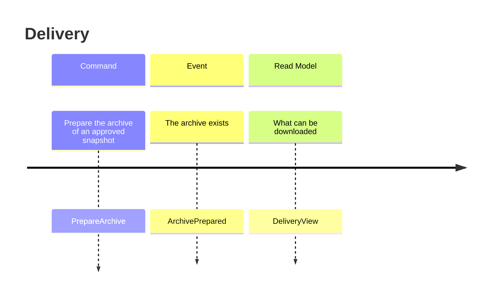

<!-- markdownlint-disable-file -->
# Event model — Delivery (`delivery`)

State changed by these slices: the `Delivery` aggregate root.

Scope of this slice set: turning an approved snapshot into a downloadable archive, and answering
whether a download exists. The pull-request channels are described in `ARCHITECTURE.md` and are not
modelled until their own slice.

The files a delivery writes are those of `ApprovedSnapshotView`, read from the open host service of
Proposal and decision ([proposal.md](proposal.md) slice PD-5) and copied into this context's own
`ArchiveEntry` values. Nothing is written for a proposal that is not approved.

## Slice DL-1 — Prepare the archive of an approved snapshot

| Step | Kind | Name | Fields |
|---|---|---|---|
| 1 | Command | `PrepareArchive` | `TeamSpaceId: TeamSpaceId`, `ProposalId: ProposalId`, `RequestedBy: MemberId` |
| 2 | Event | `ArchivePrepared` | `TeamSpaceId: TeamSpaceId`, `DeliveryId: DeliveryId`, `ProposalId: ProposalId`, `Revision: count`, `Channel: DeliveryChannel`, `ArchiveName: ArchiveName`, `EntryCount: count` |
| 3 | Read Model | `DeliveryView` | `Accepted: yes/no`, `RefusalReason: text?`, `DeliveryId: DeliveryId?`, `ProposalId: ProposalId`, `Revision: count?`, `Channel: DeliveryChannel?`, `ArchiveName: ArchiveName?`, `Entries: list of ArchiveEntryView`, `DownloadLocation: text?` |
| 3a | Read Model | `ArchiveEntryView` | `Path: text`, `ContentHash: text` |

Observed: `ArchivePrepared` and `DeliveryView.Entries` holding the APIExamples document of the
approved snapshot at its output path, each entry carrying the content hash the snapshot froze; a
second `PrepareArchive` for the same proposal revision and channel yields the same `DeliveryId` and
the same entries.

## Slice DL-2 — Offer a download only for an approved proposal

| Step | Kind | Name | Fields |
|---|---|---|---|
| 1 | Query | `GetDelivery` | `TeamSpaceId: TeamSpaceId`, `ProposalId: ProposalId`, `Channel: DeliveryChannel`, `RequestedBy: MemberId` |
| 2 | Read Model | `DeliveryView` | as in DL-1 |

Observed: while the proposal is not approved, `DeliveryView.Accepted` is no, `Entries` is empty,
`DownloadLocation` is absent and `RefusalReason` says the proposal is not approved — which is how
"no download is offered" is observed; once it is approved and the archive prepared, `Accepted` is
yes and `DownloadLocation` names where the archive is fetched. The archive fetched there carries the
APIExamples document of the approved snapshot, which is what an end-to-end run compares with the
versioned reference document of the same API and version.

`Accepted` and `RefusalReason` are the fields every read model of the project uses for the outcome
of a read, `TeamSpaceView` and `ApprovedSnapshotView` included (`CONTRIBUTING.md` § Naming); a
download is available exactly when `Accepted` is yes, so no second flag says it.

`GetDelivery` is a pure read: it raises no event.
