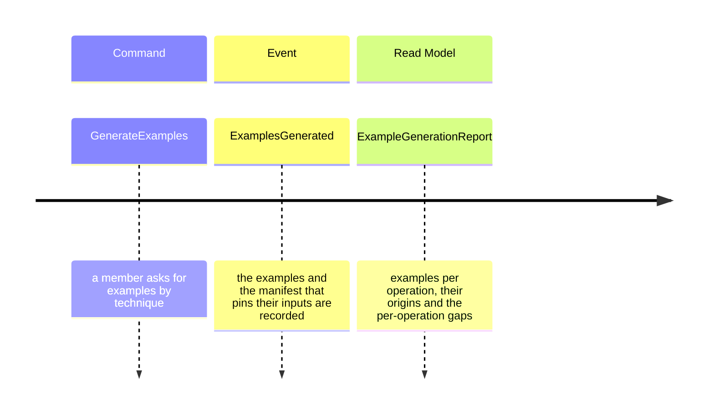

<!-- markdownlint-disable-file -->
# Event model — Test design (`design`)

Slices of the current stories only. Names here are the ones the code, the scenarios and the
tactical design ([../../architecture/design.md](../../architecture/design.md)) use.

## Slice TD-1 — One nominal example per operation

Least deliverable value: every operation of a loaded contract gets one nominal example labelled
with its technique, from inputs a manifest pins.

| Step | Kind | Name | Fields |
| --- | --- | --- | --- |
| 1 | Command | `GenerateExamples` | `TeamSpaceId: TeamSpaceId`, `MemberId: MemberId`, `ManagedApiId: ManagedApiId`, `ContractHash: text`, `Techniques: list of Technique` |
| 2 | Domain Event | `ExamplesGenerated` | `TeamSpaceId: TeamSpaceId`, `ManagedApiId: ManagedApiId`, `ProposalId: ProposalId`, `ContractHash: text`, `GenerationManifestHash: text`, `Techniques: list of Technique`, `ExampleCount: count` |
| 3 | Read Model | `ExampleGenerationReport` | `ManagedApiId: ManagedApiId`, `GenerationManifestHash: text`, `Seed: Seed`, per example `OperationKey: OperationKey`, per example `Technique: Technique`, per example `ExampleName: text`, per example `AlgorithmRef: AlgorithmRef`, per example `ValueOrigins: list of ValueOrigin`, `Gaps: list of GenerationGap` |

Observed: `ExampleGenerationReport` — one example per `OperationKey` whose `Technique` is
`Nominal`, each conforming to the declared response schema of its operation; two
`ExamplesGenerated` of the same contract and the same team context snapshot carrying the same
`GenerationManifestHash`, and the files they produce being identical byte for byte. The refusal of
`GenerateExamples` when the team context snapshot carries no seed is also watched: it changes no
state, raises no event, and its reason names the configuration file and the missing key.

## Slice TD-2 — Declared-error examples and one negative example per constraint

Least deliverable value: every declared error response of an operation gets its example, every
declared constraint gets one negative example attached to that error response, and an operation
that declares no error response is reported instead of being given an invented one.

| Step | Kind | Name | Fields |
| --- | --- | --- | --- |
| 1 | Command | `GenerateExamples` | as in slice TD-1, with `Techniques` holding `DeclaredError` and `NegativePerConstraint` |
| 2 | Domain Event | `ExamplesGenerated` | as in slice TD-1 |
| 3 | Read Model | `ExampleGenerationReport` | as in slice TD-1, plus per example `DeclaredResponse: DeclaredResponse?` and per example `ViolatedConstraint: Constraint?` |

Observed: one example per declared error response, its `Technique` being `DeclaredError` and its
value absent from the contract; for a required field with a declared format and a declared
validation error response, one example whose `ViolatedConstraint` is the format and one whose
`ViolatedConstraint` is the required rule, both carrying the same `DeclaredResponse`; and, for an
operation that declares no error response, `ExampleGenerationReport.Gaps` holding a
`GenerationGap` of kind `NoDeclaredErrorResponse` and no example of technique `DeclaredError` or
`NegativePerConstraint` for it.

## Not a trigger of this context

Reading the team context snapshot, building the generation manifest and submitting the result to
the Proposal and decision context are steps inside the `GenerateExamples` use case, not commands
of this context.
