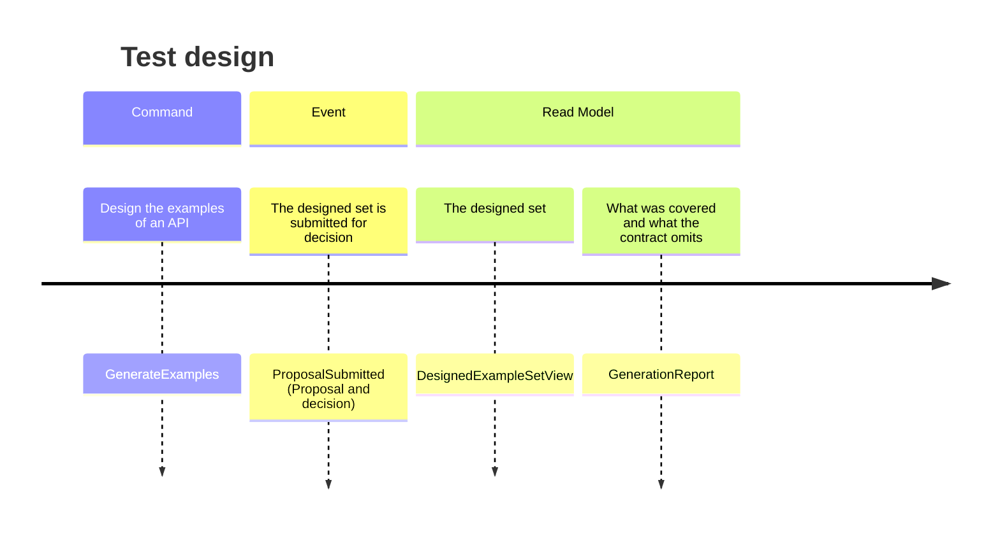

<!-- markdownlint-disable-file -->
# Event model — Test design (`design`)

Scope of this slice set: designing APIExamples from a contract revision and a team context
snapshot — one nominal example per operation, one example per declared error response, one negative
example per field constraint — then submitting them for human decision and reporting what the
contract did not declare.

No state of this context changes: a generation reads its inputs, computes and keeps nothing, so
there is no fact of its own to record
([../../architecture/design.md](../../architecture/design.md) § Domain events). What a generation
produces becomes the `Proposal` aggregate root of another context, reached through its open host
service, and the fact that aggregate raises — `ProposalSubmitted` — is the recorded successful
outcome of `GenerateExamples` in every slice below.

One trigger serves every slice: the generation requested by a person or by the CLI. It carries no
technique selector; a technique is applied when its designer exists in the catalogue, and each
slice below adds one. The seed is never passed in the trigger: it comes from the team context
snapshot, so that the same inputs give the same bytes.

## Slice TD-1 — One nominal example per operation

| Step | Kind | Name | Fields |
|---|---|---|---|
| 1 | Command | `GenerateExamples` | `TeamSpaceId: TeamSpaceId`, `RequestedBy: MemberId`, `ManagedApiId: ManagedApiId` |
| 2 | Event | `ProposalSubmitted` | raised by the `Proposal` aggregate root; fields in [proposal.md](proposal.md) slice PD-1 |
| 3 | Read Model | `DesignedExampleSetView` | `ManagedApiId: ManagedApiId`, `ApiName: text`, `ApiVersion: text`, `DocumentPath: text`, `DocumentHash: text`, `Seed: Seed`, `GenerationManifestHash: text`, `ProposalId: ProposalId`, `Examples: list of DesignedExampleView` |
| 3a | Read Model | `DesignedExampleView` | `OperationKey: OperationKey`, `ExampleName: text`, `Technique: DesignTechnique`, `AttachedResponseStatus: whole number`, `AlgorithmRef: AlgorithmRef`, `ValueOrigins: list of ValueOriginView`, `ViolatedConstraint: FieldConstraintKind?`, `OmittedField: text?` |
| 3b | Read Model | `ValueOriginView` | `FieldPath: text`, `Origin: one of Contract \| GherkinExamples \| TeamDictionary \| PromotedMemory \| DeterministicGenerator \| Ai`, `AlgorithmRef: AlgorithmRef?` |

Observed: one `DesignedExampleSetView.Examples` entry per operation of the contract, each with
`Technique` = `Nominal`, its `AttachedResponseStatus` equal to the declared success response and a
`ValueOrigins` entry for every field it fills.

## Slice TD-2 — One example per declared error response, and the report of an absence

| Step | Kind | Name | Fields |
|---|---|---|---|
| 1 | Command | `GenerateExamples` | as in TD-1 |
| 2 | Event | `ProposalSubmitted` | as in TD-1 |
| 3 | Read Model | `DesignedExampleSetView` | as in TD-1 |
| 4 | Read Model | `GenerationReport` | `Accepted: yes/no`, `RefusalReason: text?`, `ConfigurationFile: text?`, `MissingConfigurationKey: text?`, `OperationsCovered: count`, `TechniquesApplied: list of DesignTechnique`, `OperationsWithoutDeclaredError: list of OperationKey` — each a `MissingDeclaredError` |

Observed: a `DesignedExampleSetView.Examples` entry with `Technique` = `DeclaredError` for every
declared error response of an operation, and `GenerationReport.OperationsWithoutDeclaredError`
holding every operation whose contract declares none — for which no error example exists in
`DesignedExampleSetView.Examples`.

## Slice TD-3 — One negative example per field constraint

| Step | Kind | Name | Fields |
|---|---|---|---|
| 1 | Command | `GenerateExamples` | as in TD-1 |
| 2 | Event | `ProposalSubmitted` | as in TD-1 |
| 3 | Read Model | `DesignedExampleSetView` | as in TD-1 |

Observed: for a field carrying a constraint, a `DesignedExampleSetView.Examples` entry with
`Technique` = `NegativeConstraint` and `ViolatedConstraint` set to that constraint's kind — plus,
for a required field, one entry whose `OmittedField` names it — each with
`AttachedResponseStatus` equal to a declared error response of the operation.

## Slice TD-4 — The team seed makes a generation reproducible

| Step | Kind | Name | Fields |
|---|---|---|---|
| 1 | Command | `GenerateExamples` | as in TD-1 |
| 2 | Event | `ProposalSubmitted` | as in TD-1 |
| 3 | Read Model | `DesignedExampleSetView` | as in TD-1 |
| 4 | Read Model | `GenerationReport` | as in TD-2 |

Observed: two generations of the same contract with the same team context snapshot give the same
`DesignedExampleSetView.DocumentHash` and the same `GenerationManifestHash`; when the team
configuration carries no seed, `GenerationReport.Accepted` is no and `RefusalReason`,
`ConfigurationFile` and `MissingConfigurationKey` name the file and the key, no `ProposalSubmitted`
is recorded and no proposal exists.
