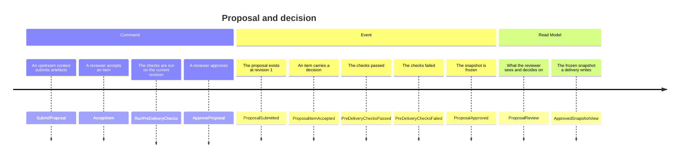

<!-- markdownlint-disable-file -->
# Event model — Proposal and decision (`proposal`)

Scope of this slice set: receiving designed artefacts for review, recording a decision on each
item, running the checks that must pass before anything leaves, approving — which freezes the
snapshot a delivery may use — and handing that snapshot to a delivery. Nothing leaves without this
approval.

State changed by these slices: the `Proposal` aggregate root, and the `ReviewItem` entity inside
it, which is the unit a person decides on.

The reviewer reads the proposal through one query, `GetProposal`, which is a pure read and raises
no event; its result is the `ProposalReview` read model used by every slice below.

## Slice PD-1 — Submit designed artefacts for human decision

| Step | Kind | Name | Fields |
|---|---|---|---|
| 1 | Command | `SubmitProposal` | `TeamSpaceId: TeamSpaceId`, `ManagedApiId: ManagedApiId?`, `Kind: ProposalKind`, `SubmittedBy: MemberId`, `Files: list of FileChange`, `Items: list of ReviewItem` — each carrying its `Provenance`, `GenerationManifestHash: text?` |
| 2 | Event | `ProposalSubmitted` | `TeamSpaceId: TeamSpaceId`, `ProposalId: ProposalId`, `ManagedApiId: ManagedApiId?`, `Kind: ProposalKind`, `Revision: count`, `ItemCount: count`, `GenerationManifestHash: text?` |
| 3 | Read Model | `ProposalReview` | `ProposalId: ProposalId`, `TeamSpaceId: TeamSpaceId`, `ManagedApiId: ManagedApiId?`, `Kind: ProposalKind`, `Revision: count`, `Files: list of FileChangeView`, `Items: list of ReviewItemView`, `PendingItemCount: count`, `Checks: CheckReportView?`, `Approved: yes/no`, `RefusalReason: text?` |
| 3a | Read Model | `FileChangeView` | `Path: text`, `Diff: text`, `Reasons: list of text` |
| 3b | Read Model | `ReviewItemView` | `ReviewItemId: identifier`, `OperationKey: OperationKey`, `ExampleName: text`, `Technique: DesignTechnique`, `AlgorithmRef: AlgorithmRef`, `ValueOrigins: list of ValueOriginView`, `Decision: one of Pending \| Accepted \| Corrected \| Rejected` |
| 3c | Read Model | `CheckReportView` | `Revision: count`, `Passed: yes/no`, `ApiExamplesValid: yes/no`, `OperationKeysMatchContract: yes/no`, `Findings: list of text` |
| 4 | Query | `GetProposal` | `TeamSpaceId: TeamSpaceId`, `ProposalId: ProposalId`, `RequestedBy: MemberId` |

Observed: `ProposalReview.Items` — one entry per designed example, each carrying the technique and
the algorithm that produced it; `ProposalReview.PendingItemCount` equal to the item count, and
`ProposalReview.Approved` no.

## Slice PD-2 — Record a decision on an item

| Step | Kind | Name | Fields |
|---|---|---|---|
| 1 | Command | `AcceptItem` | `TeamSpaceId: TeamSpaceId`, `ProposalId: ProposalId`, `ReviewItemId: identifier`, `DecidedBy: MemberId` |
| 2 | Event | `ProposalItemAccepted` | `TeamSpaceId: TeamSpaceId`, `ProposalId: ProposalId`, `ReviewItemId: identifier`, `Revision: count`, `DecidedBy: MemberId`, `DecidedAt: date` |
| 3 | Read Model | `ProposalReview` | as in PD-1 |

Observed: the `ProposalReview.Items` entry of the item moves to `Decision` = `Accepted` and
`ProposalReview.PendingItemCount` drops by one.

## Slice PD-3 — Run the checks that must pass before anything leaves

| Step | Kind | Name | Fields |
|---|---|---|---|
| 1 | Command | `RunPreDeliveryChecks` | `TeamSpaceId: TeamSpaceId`, `ProposalId: ProposalId`, `RequestedBy: MemberId` |
| 2 | Event | `PreDeliveryChecksPassed` | `TeamSpaceId: TeamSpaceId`, `ProposalId: ProposalId`, `Revision: count` |
| 2b | Event | `PreDeliveryChecksFailed` | `TeamSpaceId: TeamSpaceId`, `ProposalId: ProposalId`, `Revision: count`, `FindingCount: count` |
| 3 | Read Model | `ProposalReview` | as in PD-1 |

Observed: `ProposalReview.Checks` for the current revision, with `ApiExamplesValid` and
`OperationKeysMatchContract` and the resulting `Passed`. A passing report has no finding, which is
why only the failure carries a count.

## Slice PD-4 — Approve, which freezes the snapshot

| Step | Kind | Name | Fields |
|---|---|---|---|
| 1 | Command | `ApproveProposal` | `TeamSpaceId: TeamSpaceId`, `ProposalId: ProposalId`, `ApprovedBy: MemberId` |
| 2 | Event | `ProposalApproved` | `TeamSpaceId: TeamSpaceId`, `ProposalId: ProposalId`, `ManagedApiId: ManagedApiId?`, `Revision: count`, `ApprovedBy: MemberId`, `ApprovedAt: date`, `SnapshotHash: text` |
| 3 | Read Model | `ProposalReview` | as in PD-1 |

Observed: `ProposalReview.Approved` yes and `ProposalApproved` once every item carries a decision
and the checks of the current revision passed; otherwise `ProposalReview.Approved` stays no,
`ProposalReview.RefusalReason` names how many items are still pending, and no `ProposalApproved` is
recorded. A refused approval changes no state, so it raises no event.

`Approved` is the proposal's own state, so it keeps that name; the refusal is named `RefusalReason`,
the one name every read model of the project gives a refusal (`CONTRIBUTING.md` § Naming).

## Slice PD-5 — Hand the frozen snapshot to a delivery

| Step | Kind | Name | Fields |
|---|---|---|---|
| 1 | Query | `FindApprovedSnapshot` | `TeamSpaceId: TeamSpaceId`, `ProposalId: ProposalId`, `RequestedBy: MemberId` |
| 2 | Read Model | `ApprovedSnapshotView` | `Accepted: yes/no`, `RefusalReason: text?`, `ProposalId: ProposalId`, `Revision: count?`, `SnapshotHash: text?`, `Files: list of ApprovedFileView` |
| 2a | Read Model | `ApprovedFileView` | `Path: text`, `Content: text`, `ContentHash: text` |

Observed: while the proposal is not approved, `ApprovedSnapshotView.Accepted` is no, `Files` is
empty and `RefusalReason` says the proposal is not approved; once approved, `Files` holds one entry
per file of the frozen snapshot, each with the content and the content hash approval froze, and a
rejected item's content appears in none of them.

`Accepted` and `RefusalReason` are the fields `ContractLoadResult`, `TeamContextView`,
`GenerationReport`, `TeamSpaceView` and `DeliveryView` use for the outcome of a read: one shape for
a refusal, everywhere a source is read (`CONTRIBUTING.md` § Naming).

`FindApprovedSnapshot` is a pure read of the open host service: it raises no event, it is the only
way another context obtains the approved files, and it grows by addition only. It names its caller,
like every other query of this context, because membership is checked for that caller before the
read is served. The consumer copies what it reads into values of its own rather than keeping this
shape ([../../architecture/context-map.md](../../architecture/context-map.md)).
