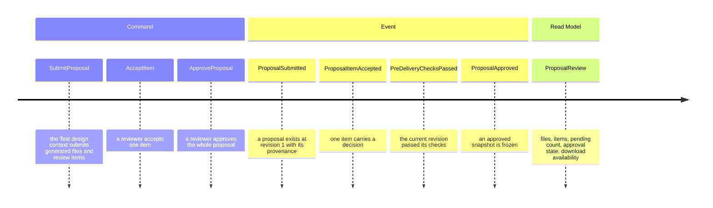

<!-- markdownlint-disable-file -->
# Event model — Proposal and decision (`proposal`)

Slices of the current stories only. Names here are the ones the code, the scenarios and the
tactical design ([../../architecture/proposal.md](../../architecture/proposal.md)) use.

## Slice PR-1 — Submit generated examples for review

Least deliverable value: a reviewable proposal whose every item shows the technique, the algorithm
and the origin of its values.

| Step | Kind | Name | Fields |
| --- | --- | --- | --- |
| 1 | Command | `SubmitProposal` | `TeamSpaceId: TeamSpaceId`, `ManagedApiId: ManagedApiId`, `ProposalKind: ProposalKind`, `SubmittedBy: MemberId`, `Files: list of FileChange`, `Items: list of ReviewItem`, `GenerationManifestHash: text` |
| 2 | Domain Event | `ProposalSubmitted` | `ProposalId: ProposalId`, `TeamSpaceId: TeamSpaceId`, `ManagedApiId: ManagedApiId`, `ProposalKind: ProposalKind`, `Revision: count`, `ItemCount: count`, `GenerationManifestHash: text` |
| 3 | Read Model | `ProposalReview` | `ProposalId: ProposalId`, `Revision: count`, per file `Path: text`, per file `Diff: text`, per file `Reasons: list of text`, per item `ReviewItemId: ReviewItemId`, per item `Technique: Technique`, per item `AlgorithmRef: AlgorithmRef`, per item `ValueOrigins: list of ValueOrigin`, per item `DecisionState: DecisionState`, `PendingCount: count`, `ApprovalState: ApprovalState`, `DownloadAvailable: yes/no` |

The command's actor is the Test design context through the open host service; a member never
calls it directly.

Observed: `ProposalReview` — one item per operation with `Technique` `Nominal`, and one item per
declared error response and per violated constraint, each showing its technique, its algorithm
reference and the origin of its values.

## Slice PR-2 — Accept one review item

Least deliverable value: a decision recorded on one item, visible in the pending count.

| Step | Kind | Name | Fields |
| --- | --- | --- | --- |
| 1 | Command | `AcceptItem` | `TeamSpaceId: TeamSpaceId`, `ProposalId: ProposalId`, `Revision: count`, `ReviewItemId: ReviewItemId`, `MemberId: MemberId`, `DecidedAt: date` |
| 2 | Domain Event | `ProposalItemAccepted` | `ProposalId: ProposalId`, `Revision: count`, `ReviewItemId: ReviewItemId`, `DecidedBy: MemberId`, `DecidedAt: date` |
| 3 | Read Model | `ProposalReview` | as in slice PR-1: the item's `DecisionState` becomes `Accepted` and `PendingCount` decreases |

Observed: `ProposalReview.PendingCount` reaching zero once every item is accepted, and staying
above zero while one item waits for a decision.

## Slice PR-3 — Approve the proposal and freeze its snapshot

Least deliverable value: an approval that exists only when every item is decided and the current
revision passed its checks, and that opens the download.

| Step | Kind | Name | Fields |
| --- | --- | --- | --- |
| 1 | Command | `ApproveProposal` | `TeamSpaceId: TeamSpaceId`, `ProposalId: ProposalId`, `Revision: count`, `MemberId: MemberId`, `ApprovedAt: date` |
| 2 | Domain Event | `PreDeliveryChecksPassed` | `ProposalId: ProposalId`, `Revision: count`, `Checks: list of CheckName`, `CheckedAt: date` |
| 3 | Domain Event | `ProposalApproved` | `ProposalId: ProposalId`, `TeamSpaceId: TeamSpaceId`, `ManagedApiId: ManagedApiId`, `Revision: count`, `ApprovedSnapshotHash: text`, `ApprovedBy: MemberId`, `ApprovedAt: date` |
| 4 | Read Model | `ProposalReview` | as in slice PR-1: `ApprovalState` becomes `Approved` and `DownloadAvailable` becomes yes |

Observed: `ProposalReview.DownloadAvailable` being no while `ApprovalState` is `NotApproved`, and
`ProposalApproved` carrying the snapshot the archive is built from. The refusal of
`ApproveProposal` while `PendingCount` is above zero is also watched: it changes no state, raises
no event, and its reason names the number of pending items.
