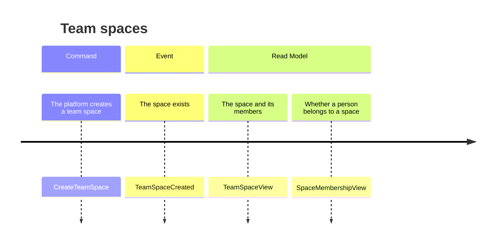

<!-- markdownlint-disable-file -->
# Event model — Team spaces (`space`)

Scope of this slice set: the minimal isolated space of one team on a shared instance, and the
membership every other context checks before it answers. Export tokens, AI providers and retention
are described in `ARCHITECTURE.md` and are not modelled until their own slice.

State changed by these slices: the space itself, written once with its slug, its display name and
its members. It is a self-validating entity rather than an aggregate root, because no story of this
slice set changes it after it is created
([../../architecture/space.md](../../architecture/space.md) § Aggregates); it still records the fact
of its creation, which is the successful outcome of the command that created it.

## Slice SP-1 — Create an isolated team space

| Step | Kind | Name | Fields |
|---|---|---|---|
| 1 | Command | `CreateTeamSpace` | `Slug: SpaceSlug`, `DisplayName: text`, `Members: list of MemberId`, `CreatedBy: MemberId` |
| 2 | Event | `TeamSpaceCreated` | `TeamSpaceId: TeamSpaceId`, `Slug: SpaceSlug`, `CreatedBy: MemberId` |
| 3 | Read Model | `TeamSpaceView` | `Accepted: yes/no`, `RefusalReason: text?`, `TeamSpaceId: TeamSpaceId?`, `Slug: SpaceSlug?`, `DisplayName: text?`, `Members: list of MemberId` |

Observed: a `TeamSpaceView` per space with `Accepted` yes, two spaces of the same instance sharing
no member unless the platform placed the same person in both; a second space with the same slug is
refused, so no second space exists for that slug and no second `TeamSpaceCreated` is recorded.

## Slice SP-2 — Read the space a person belongs to

| Step | Kind | Name | Fields |
|---|---|---|---|
| 1 | Query | `GetTeamSpace` | `RequestedBy: MemberId`, `Slug: SpaceSlug?` |
| 2 | Read Model | `TeamSpaceView` | as in SP-1 |

Observed: `TeamSpaceView.Accepted` yes with the space and its members for a space the caller
belongs to; `Accepted` no with a `RefusalReason` and no space field otherwise — the same refusal,
word for word, whether the space does not exist or the caller is not one of its members, so that
nothing leaks about another team's spaces. `Accepted` and `RefusalReason` are the fields every read
model of the project uses for the outcome of a read (`CONTRIBUTING.md` § Naming).

## Slice SP-3 — Answer every other context's membership question

| Step | Kind | Name | Fields |
|---|---|---|---|
| 1 | Query | `FindSpaceMembership` | `TeamSpaceId: TeamSpaceId`, `MemberId: MemberId` |
| 2 | Read Model | `SpaceMembershipView` | `TeamSpaceId: TeamSpaceId`, `MemberId: MemberId`, `Member: yes/no` |

Observed: `SpaceMembershipView.Member` yes for a member of that space and no for anyone else,
including when the space does not exist — which is what makes every command and every read of
another context refusable before it runs, and what keeps one team's dictionaries, examples and
proposals out of another team's answers.

The trigger of this slice comes from outside the use case: another context asks before it answers
its own caller. `GetTeamSpace` and `FindSpaceMembership` are pure reads: they raise no event. The
caller's identity is established outside the model, at the entry point.

## Facts this slice set does not model as events

| Fact | Why not here |
|---|---|
| `TrafficTokenIssued`, `TrafficTokenRevoked`, `AiProviderSelected`, `AiProviderEnabled`, `AiProviderDisabled` | Their commands are out of this slice set (PRD E2.7, E4.5). |

`TeamSpaceCreated` has no consumer in this slice set — its ratified consumers are Traffic
observation and Test design (`ARCHITECTURE.md` § Domain events) — and no acceptance criterion
observes it: what the stories observe is `TeamSpaceView`. It is modelled all the same, because it
is the recorded successful outcome of `CreateTeamSpace`.
