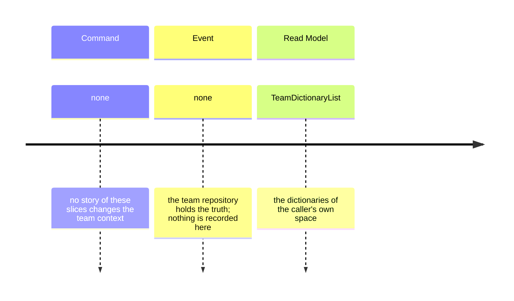

<!-- markdownlint-disable-file -->
# Event model — Team context (`teamcontext`)

Slices of the current stories only. Names here are the ones the code, the scenarios and the
tactical design ([../../architecture/teamcontext.md](../../architecture/teamcontext.md)) use.

## Slice TC-1 — List the dictionaries of my own space

Least deliverable value: a member sees the dictionaries of the space they belong to, and only
those.

| Step | Kind | Name | Fields |
| --- | --- | --- | --- |
| 1 | Query | `ListTeamDictionaries` | `TeamSpaceId: TeamSpaceId`, `MemberId: MemberId` |
| 2 | Read Model | `TeamDictionaryList` | `TeamSpaceId: TeamSpaceId`, `SourceRevision: text`, per entry `DictionaryName: text`, per entry `ValueCount: count` |

The query changes no state and raises no event.

Observed: `TeamDictionaryList` — a dictionary of another space never appears in it, whatever its
name.

## Not a trigger of this context

Reading `.foundry/config.yaml` and the dictionaries of a space is a step inside the
`GenerateExamples` use case of the Test design context, which reads the snapshot at a revision
through this context's gateway. The seed and the PR language are therefore observed through that
generation, not through a command of this context. No command of these slices changes the team
context: the team's git repository is the source of truth, and a change to it arrives as a
proposal in a later tranche.
