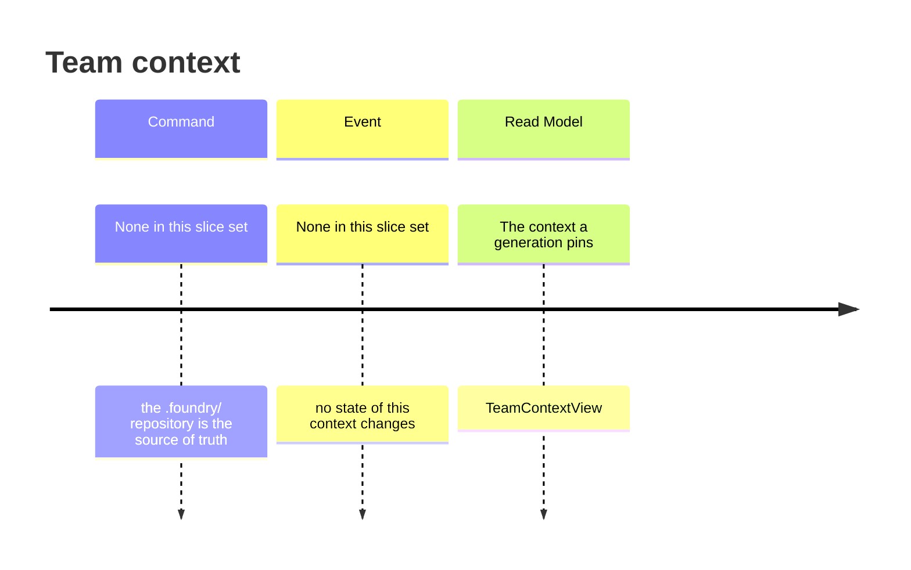

<!-- markdownlint-disable-file -->
# Event model — Team context (`teamcontext`)

Scope of this slice set: reading a team's own `.foundry/` content at a revision — its seed, its PR
language and its dictionaries — as one immutable snapshot a generation can pin, and showing the
caller only what belongs to their own space. The team's git repository is the source of truth, so
nothing here changes state: no aggregate, no command and no event in this slice set. Learned values
and their promotion are described in `ARCHITECTURE.md` and are not modelled until their own slice.

## Slice TC-1 — Read the team context a generation pins

| Step | Kind | Name | Fields |
|---|---|---|---|
| 1 | Query | `GetTeamContext` | `TeamSpaceId: TeamSpaceId`, `RequestedBy: MemberId` |
| 2 | Read Model | `TeamContextView` | `Accepted: yes/no`, `RefusalReason: text?`, `TeamSpaceId: TeamSpaceId`, `SourceRevision: text`, `ConfigurationFile: text`, `MissingConfigurationKey: text?`, `Seed: whole number?`, `PrLanguage: one of fr \| en`, `Dictionaries: list of TeamDictionaryView`, `SnapshotHash: text?` |
| 2a | Read Model | `TeamDictionaryView` | `DictionaryName: text`, `EntryCount: count` |

The ratified result of this query also carries the team's algorithms, memory and skills; those
parts arrive with the slices that produce them. No story of this pass shows them.

The published view carries only fields of its own: the seed as a number, each dictionary as a name
and an entry count. Behind it, this context holds the seed as its `Seed` value object and one
`DictionaryRef` per dictionary, and neither crosses the boundary
([../../architecture/teamcontext.md](../../architecture/teamcontext.md) § Value objects): the Core
consumer builds its own `Seed` from the number it reads.

`Accepted`, `RefusalReason`, `ConfigurationFile` and `MissingConfigurationKey` are the same fields,
under the same names, that `ContractLoadResult`, `GenerationReport`, `ApprovedSnapshotView`,
`DeliveryView` and `TeamSpaceView` use for the outcome of a read: one shape for a refusal,
everywhere a source is read (`CONTRIBUTING.md` § Naming).

`TeamContextView` is what this context publishes, and the only shape that crosses its boundary; the
Core consumer translates it into its own values before designing anything
([../../architecture/context-map.md](../../architecture/context-map.md)).

Observed: `TeamContextView.Seed` and `TeamContextView.SnapshotHash`, equal for two reads of the same
revision; when the configuration carries no seed, `Accepted` is no and `RefusalReason`,
`ConfigurationFile` and `MissingConfigurationKey` name the file and the key that is absent.

## Slice TC-2 — Show only what belongs to the caller's space

| Step | Kind | Name | Fields |
|---|---|---|---|
| 1 | Query | `GetTeamContext` | `TeamSpaceId: TeamSpaceId`, `RequestedBy: MemberId` |
| 2 | Read Model | `TeamContextView` | as in TC-1 |

Observed: `TeamContextView.Dictionaries` holds the dictionaries of the caller's own space and no
dictionary of another space, whatever its name; a request for a space the caller is not a member of
is refused before anything is read, on the answer of `FindSpaceMembership`.

`GetTeamContext` is a pure read: it raises no event.
